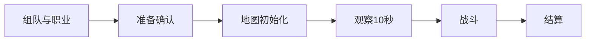

# 战墙重生 · 对局策划案

首版对局规则。每项数值只写在所属章节；表内为初值。实现时把这些初值集中放在同一处配置，改数值不改规则。

文中三种标记：

| 标记 | 含义 |
| --- | --- |
| 【待定】 | 规则尚未写完，或原文两处说法不一致，不能当作已拍板的规则实现 |
| 【暂定】 | 先按此实现，正文已标明以后要再调 |
| 【首版不做】 | 这一版明确不做。类别或入口可以保留 |

未完成项在对应规则旁标注，并集中列在 [未完成与首版范围](#10-未完成与首版范围)。

## 1. 概述

两支队伍在同一张平原上对攻。玩家用资源在三件事之间取舍：给自己买装备、放置建筑、召唤怪物。怪物会自行走向最近的敌方建筑并拆核心。任意一方的基地核心生命归零，对局结束。

玩家本人可以参与战斗，也可以采矿式地拆敌方核心。人离开基地去打架或拆家时，资源、防守和出兵都会慢下来。

两个容易混淆的词：

| 词 | 含义 |
| --- | --- |
| 建筑核心 | 每座建筑都有的那一个功能方块。右键打开面板，生命归零则整座建筑消失。 |
| 核心建筑 | 建筑类别。首版只有基地属于这一类。 |

另外两类是普通建筑和奇观。奇观这一版没有具体内容，类别先留着，见 [奇观](#512-奇观)。

## 2. 对局流程

开服时若记分板上还没有红队和蓝队，则创建红队（红色）和蓝队（蓝色），并关闭这两支队伍的队友伤害。队伍已经存在时，只关掉队友伤害，不改颜色和其他设置，也不自动把玩家分进去。

### 2.1 组队与职业

- 固定两队。玩家由指令 `/ww side red` 或 `/ww side blue` 分入一队。未分队的玩家不能确认准备。
- 局外与局内打开不同的菜单界面。局外为大厅终端，含更新公告、加入游戏、职业、怪物、建筑五个板块；分队、准备和旁观在「加入游戏」板块中完成。菜单物品的发放、切换与各板块说明见 [菜单物品、大厅终端与局内终端](#29-菜单物品大厅终端与局内终端)。确认界面也可用 `/ww match` 打开。管理员可以在界面里重置，也可以用 `/ww match reset`。旁观会退出当前队伍，并取消准备。地图已经生成时以旁观模式进入竞技场，观察、战斗、结算均可观看；地图尚未生成时提示现在没有对局。已经分队的玩家重连后仍进入当前阶段。
- 每队人数不限。启动资源、兵营间隔和基地生命不随人数变化。数值按大约 1 到 4 人对 1 到 4 人拟定。
- 每队至少一名在线玩家，才能进入后面的确认。
- 分队之后默认职业是矿工。没有空白职业。大厅职业板可以选择矿工、破坏手、堡垒、驱魔人、征服者、冠军和指挥官，点选后锁定。规则见 [职业](#8-职业)。

### 2.2 准备确认

当前在线、已分队的玩家各自确认准备。某一队全部在线成员都确认后，该队准备完成。两队都完成后，开始地图初始化。确认期间掉线的玩家不挡住流程；若重连时阶段已经走过，直接进入当前阶段。

### 2.3 地图初始化

只执行一次。地图在单独维度里生成，不改主世界：

1. 生成约 100×100 的平原，并放上屏障与世界边界。
2. 在对角线两端、各向内收一截的位置整平小平台，放好双方基地核心，基地朝向对方。
3. 记下每座基地朝向对方、离核心 8 格的出生点，脚下是地表，不卡在方块里。

边长、屏障高度、平台和矿石的具体规则见 [地图与地形](#3-地图与地形)。开始生成前，已经加入红队或蓝队的玩家，标题显示「正在加载地形」。初始化完成后进入观察。此时商店不能买、建筑不能放、唤灵不能用。

### 2.4 观察

玩家处于观察模式，可在边界内自由观看地形和两座基地。观察固定 10 秒。动作栏显示剩余秒数。时间到了进入战斗，不再确认「开始」。有人在这 10 秒里掉线，不延长观察。重连时阶段已经走过，处理与准备确认相同。

### 2.5 战斗开始

观察满 10 秒后：

- 玩家变为生存模式，生命和饥饿回满，传到己方出生点。饥饿回到刚进服的 20 点，饱食度 5。
- 清空背包，穿上铜头盔、铜胸甲、铜护腿和铜靴子，并得到铜斧、铜镐、铜铲、铜锄各一把，以及对应职业的技能物品，见 [职业](#8-职业)。同时发放局内终端，见 [菜单物品、大厅终端与局内终端](#29-菜单物品大厅终端与局内终端)。当时在线的每名队员获得铁锭 ×64、铜锭 ×64。指挥官不获得这两样，改为获得一座 3 级指挥官兵营。不另发生成建筑。
- 允许玩家之间的敌对伤害。红队和蓝队关闭友军伤害：同队玩家和同队唤灵互相打不出血。
- 建筑产出、弩架、特斯拉塔、炮台、兵营、掠夺者哨塔、农田（小麦生长与农民工作）、怪物寻路开始工作。商店从这一阶段起可以购买。

观察、战斗或结算开始后，不能再把玩家分进红队或蓝队。已经在队伍里的玩家重连仍留在原来的队伍。已经分队、第一次进入战斗时生命和饥饿回满，清空背包并获得这套铜装备、对应职业的技能物品和局内终端，不再补铁锭和铜锭。已经领过初始装备的玩家重连不会再清一次背包，也不会把生命和饥饿设回满。

### 2.6 胜负与结算

只有基地核心的生命归零，或一队在基地总览中全员同意投降，可以判定胜负。其他建筑被拆掉，只影响资源、挡路或出兵。投降规则见 [商店](#41-商店)。

任一基地生命归零，或一队全员同意投降的瞬间：

- 该队失败，另一队获胜。
- 产出、弩架、特斯拉塔、炮台、兵营、掠夺者哨塔、农田（小麦生长与农民工作）、怪物行动和商店购买全部停止。
- 全图公告胜方。
- 所有玩家进入观察模式。
- 红队和蓝队玩家生命和饥饿回满，背包清空，再给一个局内终端，见 [菜单物品、大厅终端与局内终端](#29-菜单物品大厅终端与局内终端)。当时不在线的，下次进服时补上这一次清空。
- 地图留在原地，供查看。身在竞技场或本局中的在线玩家可以同意重置，再点一次取消自己的同意。同意人数达到这些玩家的半数（奇数向上取整）后，执行与管理员重置（界面或 `/ww match reset`）相同的重置。动作栏显示当前同意人数。管理员仍可提前重置。
- 重置时：把仍在竞技场的玩家（含红蓝队员和大厅旁观）传送回大厅，阶段回到组队与准备，清掉地图，清空团队仓库；红蓝队员生命和饥饿回满并清空背包。送回大厅的人关掉飞行、飞行许可和无敌。所有被送回大厅的人按切到大厅的规则收回局内终端和返回大厅，改发大厅终端，见 [菜单物品、大厅终端与局内终端](#29-菜单物品大厅终端与局内终端)。当时不在线的，下次进服时按当时所在场景补上清空与补发。

基地被拆掉时对局已经结束，死亡玩家不再重生进战斗。

### 2.7 死亡与重生

战斗中的死亡按原版结算。死亡信息会显示，物品和经验掉在死亡位置，不保留。局内终端和职业技能物品不在掉落里。游戏规则「立即重生」保持打开。自动重生后立刻进入旁观，标题显示「复活倒计时」和剩余秒数。8 秒后在己方出生点以生存模式复活，生命回满，状态效果和着火清掉。背包不会因为这次复活而补回。身上没有局内终端时会再给一个。身上没有对应职业的技能物品时再补一个，见 [职业](#8-职业)。基地被拆掉之后，正在倒计时的玩家留在旁观，不再进入战斗。

### 2.8 各阶段能做的事

| 阶段 | 模式 | 限制 |
| --- | --- | --- |
| 组队、准备 | 冒险（已分队的玩家进入时）。可以自己切换模式，游戏不会改回去 | 不能购买 |
| 观察 | 旁观 | 商店不能买，建筑不能放，唤灵不能用 |
| 战斗 | 生存 | 饥饿、饱食和自然回血使用原版规则，不关闭自然回血。不能合成。建筑、怪物、战斗和职业见第 5 到第 8 节 |
| 结算 | 旁观 | 不能放置、破坏、购买或攻击。产出、弩架、特斯拉塔、炮台、晶震装置、兵营、掠夺者哨塔、农田、图书馆召集与购买书架、附魔台附魔、晶化反应炉转化、超级武器冷却、打击与传送、怪物和商店已停 |

### 2.9 菜单物品、大厅终端与局内终端

菜单物品按玩家当前所在场景打开不同界面。玩家位于大厅时为局外，右键打开大厅终端；进入竞技场的观察、战斗或结算阶段为局内，右键打开局内终端。局内终端打开的是基地界面，见 [商店](#41-商店)，没有大厅终端的五个板块，也不能从这里加入、退出或旁观对局。

局外发放的菜单物品显示名为大厅终端，外形使用指南针，只借用模型和持握姿势：右键打开大厅终端，不能用来指向结构或地点，也不能与普通指南针堆叠。局内发放的菜单物品显示名为局内终端，外形使用追溯指针，只借用模型和持握姿势：右键打开局内终端，不能用来指向死亡位置或其他地点，也不能与普通追溯指针、大厅终端或普通指南针堆叠。同一人身上只保留一件对应当前场景的菜单物品，多的收回。分队不会收走当前这件。原先由扩散模块发放的便携终端取消，与局内菜单物品合为一件局内终端，见下文。

发放与切换：

- 切到大厅时，以及之后每次进服且当时处于局外时，若身上没有大厅终端则发一个。若身上仍有局内终端或返回大厅，先收回再发大厅终端。
- 进入观察阶段时，收回大厅终端，改发局内终端；其中未分队的大厅旁观同时发放返回大厅，见下文。以旁观进入已在进行的对局（观察、战斗或结算）时同样收回大厅终端、改发局内终端和返回大厅，避免把大厅终端带进竞技场。已分入红蓝队的玩家（含观察阶段、复活倒计时和结算）不发返回大厅。
- 战斗开始清空背包并发放初始装备时，同时发一个局内终端。已经分队、第一次进入战斗时同样发放。
- 结算并清空背包时，再发一个局内终端。当时不在线的，下次进服时按当时所在场景补发。
- 对局重置并把玩家送回大厅时，按切到大厅的规则收回局内终端和返回大厅，改发大厅终端。
- 战斗中复活进入生存时，身上没有局内终端则补一个。主动丢出后，身上没有就再补一个。死亡不掉在地上。

**局内终端。** 已分入红队或蓝队的玩家，在观察、战斗（含复活倒计时中的旁观）和结算阶段都可以右键打开，并可以点击界面里的格子；旁观模式不阻止打开或点击。敌方玩家打不开本队界面。未分队、以大厅旁观进入竞技场的玩家右键时打开什么【待定】。打开后默认停在第一栏团队箱。界面栏位、团队箱容量、投降和购买规则见 [商店](#41-商店)。

**返回大厅。** 未分队、以大厅旁观进入竞技场、正在观看对局的玩家，背包里额外有一件返回大厅。点击该物品（手持右键，或在背包界面中点击）即可传送回大厅；对局继续，该玩家仍为未分队。外形使用橡木门，只借用模型和持握姿势，不能当作方块放置，也不能与普通橡木门堆叠。同一人身上只留一件，多的收回；丢出后若仍在旁观则补发，死亡不掉在地上。切到大厅、被分入红队或蓝队、或对局重置送回大厅时收回。已分入队伍的玩家不发这一件，包括观察阶段、复活倒计时中的旁观，以及结算中的队员。结算阶段这件物品改为同意重置：再点一次取消，达到半数后重置回大厅，见 [胜负与结算](#26-胜负与结算)。观察和战斗中，未组队旁观点击它才是离开旁观。

在本队基地尚未装上扩散模块时，用局内终端打开，只能使用团队箱和基地总览；建筑栏与武器护甲栏在移动终端里显示为屏障，不能从这里打开商店或进行基地以外的购买与升级。装上扩散模块后，同一件局内终端即可使用商店、基地升级等其余功能，各栏与右键我方基地核心时相同。右键我方基地核心，以及从我方传输装置打开商店，不受这条限制，未装扩散模块时也是完整界面，以便在基地购买并装上扩散模块。购买仍只在战斗阶段。扩散模块不再另发第二件终端，见 [强化模块](#513-强化模块)。

大厅终端打开后有五个板块，可在其间切换。更新公告、怪物、建筑的界面已在各自板块写明。加入游戏与职业的排版与图标【待定】。

**更新公告。** 点开本板块时，默认打开最新一次公告。界面为 6 行 9 列的箱子式面板。最上方标题显示「更新公告 · 」后接该次版本号，例如「更新公告 · 1.2.8」。

标题栏以下的格子展示该次更新的内容。每个物品代表一条更新，作为该条的图标放在格子里，不能取出；该条说明写在该物品的名称或描述上。除下面写明的书架和箭矢外，其余格子都可放更新内容；一页放不下则分页。

最下一行最左一格为书架。点击后打开历次更新公告列表：同样为 6 行 9 列的箱子式面板，每次公告占一格，从左往右依次排列，一行放满则换到下一行继续向右排。点选其中一次，即打开该次公告的内容页，版式与最新一次相同。

最下一行由左数第 6 格为箭矢。该次公告有多页时显示箭矢，点击进入下一页，翻过最后一页后回到第一页，循环切换；只有一页时不显示箭矢。箭矢不能取出。

每次维护修改完成后，直接追加一条新的更新公告，不覆盖以往各次。新的公告加在历次列表已有条目的右侧（一行放满则换行）。何为一份独立版本、版本号如何书写，由策划在录入时指定，不在此预先规定。

**加入游戏。** 承担原来指南针菜单里的加入游戏与准备确认。玩家在此分入红队或蓝队、确认准备，以及选择旁观。未分队的玩家不能确认准备。准备在该板块中完成，也能看到职业的技能。管理员可以在此重置，也可以用 `/ww match reset`。`/ww side red`、`/ww side blue` 与 `/ww match` 仍可用，效果与在此板块操作相同。旁观会退出当前队伍，并取消准备。地图已经生成时以旁观模式进入竞技场，观察、战斗、结算均可观看；地图尚未生成时提示现在没有对局。两队人数、确认流程与默认职业见 [组队与职业](#21-组队与职业)、[准备确认](#22-准备确认)。

**职业。** 查阅本模组已经写入的职业：矿工、破坏手、堡垒、剑士和爆破专家。每个职业展示被动、主动，以及已定的技能物品名称与外形，内容与 [职业](#8-职业) 一致。爆破专家主动仍待补时，该职业注明主动待定，暂不发放技能物品。职业选择规则仍待补，因此本板块目前只供查阅，不能在此锁定职业；分队后默认仍是矿工。选择规则补上后，在本板块选择并锁定。

**怪物。** 打开本板块后，进入首页。界面为 6 行 9 列的箱子式面板，标题为「怪物」。首页列出当前所有可购买的唤灵，从左往右依次排列，一行放满则换到下一行。可购买以 [怪物属性](#61-属性) 表中「购买」栏已定价的单位为准，按表中现有顺序为：唤灵·僵尸、唤灵·骷髅、唤灵·蜘蛛、矿工僵尸、唤灵·尸壳、唤灵·骷髅死士、唤灵·苦力怕、唤灵·僵尸战士、唤灵·铁傀儡、唤灵·高压苦力怕、唤灵·掠夺者、唤灵·幻术师、唤灵·卫道士、唤灵·唤魔者、唤灵·劫掠兽。每个唤灵占一格，外形用对应刷怪蛋，不能取出；点击打开该唤灵的二级界面。表中增删或改名时，本列表跟着变。商店仍不出售唤灵，见 [商店](#41-商店)；本板块只供查阅，不能在此召唤或购买。无职业唤灵·村民、农民、图书管理员，以及唤魔者召唤的恼鬼，当前不能购买，不列入首页。

二级界面同样为 6 行 9 列的箱子式面板，标题为「怪物 · 」后接该唤灵名称，例如「怪物 · 唤灵·僵尸」。格子里的物品都不能取出。

- 第 1 行最左一格：该唤灵的图标，外形用对应刷怪蛋。
- 第 2 行从左到右 9 格依次为：等级、生命、盔甲、对玩家攻击、建筑破坏力、拆建筑间隔、攻击距离、弓射程、基础产出间隔。外形依次为经验瓶、苹果、铁胸甲、铁剑、石砖、时钟、末影之眼、弓、红石。每格的名称或描述写该项名称和当前数值；无弓的唤灵，弓射程一格仍保留，数值写「—」。
- 第 3 行从左到右：购买消耗（外形绿宝石，描述写资源种类和数量）、来源（兵营可生产的外形用合成器，掠夺者哨塔可生产的外形用掠夺者旗帜）、索敌（外形标靶）、补充说明（外形书）。没有补充说明时，补充说明一格空着。
- 第 4、5 行空着。
- 第 6 行最左一格为返回，外形橡木门，点击回到怪物首页。

索敌一格必须填写。没有特殊规则的唤灵，描述写下面这段默认索敌逻辑，并注明详见 [阶段与仇恨](#63-阶段与仇恨)。默认索敌逻辑：受到伤害且当前追击半径内有敌方玩家或敌方唤灵时进入反击。否则在追击半径内按下列顺序索敌：① 敌方建筑核心；② 最近的敌方唤灵；③ 最近的敌方玩家；④ 都没有则改锁全图最近的敌方建筑核心；⑤ 全图没有敌方核心则停下。已经锁住且仍符合条件的目标不会每刻丢掉。半径内的敌方唤灵和玩家大约每 0.5 秒重选一次，各唤灵错开，不挤在同一刻；建筑核心大约每 2 秒重选一次。追击半径上限 16 格。不攻击我方玩家与我方建筑。矿物反应堆是中立建筑，开局无主或被任一队占领之后，怪物都不索敌、不主动攻击。创造和旁观模式的玩家不作为目标。

有特殊规则的，索敌一格改写为该唤灵的实际规则，不再只写「默认」：

- 矿工僵尸：不走上述五步，不主动拆建筑或追击。只挖矿、回本队基地；受到伤害且追击半径内有敌方玩家或敌方唤灵时按现有反击近战，反击不拆建筑，结束后回到挖矿。
- 唤灵·蜘蛛：先写默认索敌逻辑，并注明不把城墙当作攻击目标。晶震装置和其他建筑仍会索敌。
- 唤灵·掠夺者、唤灵·幻术师、唤灵·卫道士、唤灵·唤魔者、唤灵·劫掠兽：掠夺模式下为默认索敌逻辑。由所属掠夺者哨塔放出且该塔处于固守时，改为固守索敌：以这座哨塔的固守地点为锚点，没改过时是核心中心，固守范围 32 格；无目标时在范围内巡逻，不主动拆敌方建筑，也不按默认规则去全图锁敌方核心；有目标时只比较范围内，优先正在破坏己方建筑的敌人，否则最近的敌方唤灵，再否则最近的敌方玩家；不追出范围。手持刷怪蛋放下的掠夺者系不吃固守，仍为默认索敌。唤魔者召唤的恼鬼会飞向唤魔者正在进攻的建筑并攻击；唤魔者没有建筑目标时，再按敌方建筑、敌方唤灵、敌方玩家自己索敌，不跟随固守。写在该唤灵的补充说明里。详见 [掠夺者哨塔](#511-掠夺者哨塔)。

补充说明只收录正文已经写明的内容，例如苦力怕的爆炸中心伤害与引信、矿工僵尸和僵尸战士的装备来源、骷髅死士一轮三只、幻术师的失明与幻象等。不另编新说明。二级界面的数值与索敌规则与策划案正文同步：正文改了，本界面跟着改，不另维护一套。

**建筑。** 打开本板块后，进入首页。界面为 6 行 9 列的箱子式面板，标题为「建筑」。首页列出当前所有建筑，从左往右依次排列，一行放满则换到下一行，顺序为：基地、城墙、弩架、特斯拉塔、兵营、炮台、传输装置、农田、掠夺者哨塔、晶核工坊、晶化反应炉、晶核制导炮、传送尖塔、晶震装置、图书馆、附魔台、奇观。已删除的矿物反应堆不列入。每个建筑占一格，不能取出；点击打开该建筑的二级界面。外形用商店里的核心图标：城墙为石砖，兵营为合成器，弩架为弩，特斯拉塔为避雷针，炮台为投掷器，传输装置为漏斗，掠夺者哨塔为掠夺者旗帜，农田为堆肥桶，晶核工坊为高炉，晶核制导炮为 TNT，传送尖塔为紫水晶碎片，晶化反应炉的图标【待定】，晶震装置为磁石，图书馆和附魔台的图标【待定】；基地不在商店出售，外形用信标；奇观的图标【待定】，条目仍列出，并注明首版不做具体内容。建筑增删或改名时，本列表跟着变。本板块只供查阅，不能在此购买或放置。

二级界面同样为 6 行 9 列的箱子式面板，标题为「建筑 · 」后接该建筑名称，例如「建筑 · 城墙」。格子里的物品都不能取出。

- 第 1 行最左一格：该建筑的图标，外形与首页相同。
- 第 2 行从左到右：类别、占地、功能、获得方式、模块。外形依次为命名牌、草地、书、金锭、紫色釉陶。类别写核心建筑、普通建筑或奇观，城墙额外注明同时是防御类，晶核制导炮和传送尖塔额外注明超级武器类，晶化反应炉额外注明发育建筑、商店暂列生产类，晶震装置额外注明防御类、需晶核工坊，图书馆和附魔台额外注明农业流派、商店暂列资源类（解释）。占地写边长或格数，例如 7×7、1×9、1×1；尚未确定的注明待定。功能写该建筑小节已有的功能说明。获得方式用 1、2、3 个金锭表示 1、2、3 级，描述里写该级的全部消耗；农田、图书馆和附魔台的购买价仍待定时，注明待定；图书馆和附魔台能否升级仍待定，也注明待定。模块写有无强化槽、强化槽 II 和扩散槽，以及效果见 [强化模块](#513-强化模块)；传输装置、农田、晶核工坊、晶核制导炮、传送尖塔、晶化反应炉、图书馆和附魔台写无模块槽。特斯拉塔、掠夺者哨塔和晶震装置的三个模块按 [强化模块](#513-强化模块) 写明。
- 第 3 行从左到右按等级放 1 级、2 级、3 级。每格外形与该建筑首页图标相同，描述写该级已写入的基础数值：生命，以及该建筑特有的射程、箭速、伤害、间隔、中心伤害、产出等，均与对应建筑小节的等级表一致。不能升级的建筑（传输装置、农田、晶核工坊）只放 1 级一格，并注明不能升级。图书馆和附魔台的生命、造价、能否升级仍待定，等级格注明待定。晶化反应炉按 1 / 2 / 3 级分三格，描述写生命 40、该级成功率 20% / 30% / 40%，以及 1 级升 2 级费用铁锭 ×64、铜锭 ×64，2 级升 3 级费用铁锭 ×64、铜锭 ×64、钻石 ×8；购买费用铁锭 ×48、铜锭 ×48。晶核制导炮按 1 / 2 / 3 级分三格，描述写生命 50、该级冷却 600 / 500 / 400 秒，以及每级升级费用铜锭 ×64、铁锭 ×64、钻石 ×4；购买另加钻石 ×4；传送尖塔按 1 / 2 / 3 级分三格，描述写生命 40、该级冷却 480 / 400 / 320 秒，以及每级升级费用铁锭 ×48、铜锭 ×48、钻石 ×4；购买另加钻石 ×4；晶震装置按 1 / 2 / 3 级分三格，描述写生命 20、射程 24、该级间隔 3 / 2 / 1 秒、溅射半径 3、基础伤害 5，以及 1 级升 2 级费用钻石 ×2、2 级升 3 级费用钻石 ×2；购买费用钻石 ×2。基地三级生命相同，仍分三格写清产出和升级费用。奇观无等级表，第 3 行空着。
- 第 3 行在等级格之后，若该建筑有攻击或锁定规则，再放一格索敌（外形标靶）：弩架写优先最近的、没有被实心方块挡住的敌方唤灵，没有再打没有被挡住的敌方玩家，不打我方，不拆建筑；特斯拉塔写 16 格内优先最近的、没有蓄风的敌方玩家，没有再打没有蓄风的敌方唤灵，已有蓄风的不选，不拆建筑，旁观与创造不选；炮台写射程内先锁最近的敌方唤灵，没有再锁最近的敌方玩家，两类都没有时锁敌方建筑（基地也算）；晶核制导炮写冷却就绪后在面板按开炮，进入旁观视角从天上向下看，只能选定地表位置，右键两下确认；TNT 先高速向上飞到世界顶部，再从目标地点落下，对范围内敌方造成中心伤害 120、威力半径 16，对建筑仍为 25%，不是自动索敌；传送尖塔写冷却就绪后在面板按传送，选定方式与制导炮相同，将使用的玩家及跟随其的唤灵传送至安全位置，挤不下的唤灵不传，不是自动索敌；晶震装置写 24 格内优先最大生命值最高的敌方玩家或敌方唤灵，再对主目标周围溅射半径内的敌方造成一次伤害，不拆建筑，旁观与创造不选。没有攻击的建筑不放这一格。
- 第 4、5 行空着。
- 第 6 行最左一格为返回，外形橡木门，点击回到建筑首页。

二级界面的数值与说明与策划案正文同步：正文改了，本界面跟着改，不另维护一套。待定项在对应格子里注明待定，条目保留。

## 3. 地图与地形

竞技场默认边长160格，可在120至300格之间每次增减20格。观察和战斗阶段使用同一张地图。

在竞技场里挖方块时，矿石（含深层矿石）、原木（含去皮原木和木）、木板会掉落。其他方块能挖掉，但不掉东西。战斗阶段不能使用背包合成格和工作台，已放置的合成器也不会工作。兵营核心右键仍打开兵营面板；掠夺者哨塔、农田同理。

边界做两层：

- 世界边界与这块区域的外沿重合，玩家不能走出区域。
- 区域四周有一圈屏障墙，从世界底部砌到 y=128。怪物和玩家都不能穿过去。屏障本身不能被挖掘。

地形：

- 每一局开始生成地形时，用当时的时间戳当作这一局的种子。同一局里的地表、树木和花都用这一个种子。
- 生物群系固定为平原。地表贴着原版海平面。偏移是固定的 -0.50375，再叠加原版折叠山脊乘 0.004。折叠山脊的范围是 -1 到 1，深度斜线每 1 对应 128 格，所以这一项满幅大约 1 格。大陆性仍限制在 -0.1 到 0.25，侵蚀度仍限制在 0.7 到 1，只进入坡度系数和锯齿系数；这一档锯齿系数是 0。不另加整张图的高度差上限。生成之后，上下左右相邻的两列如果地面高度差超过 1 格，就把高的那列削低，削到只比低的那列高 1 格，反复削到整张图都满足。只削高，不填低。
- 每一列实心地面从表面往下是草方块、一层泥土、三层石头、三层基岩，再下面一整层基岩。再往下是空的。世界从 y=0 到 y=191，海平面在 y=0，不生成海。
- 不生成结构（村庄、前哨站、地牢等）、洞穴、峡谷、熔岩湖和原版矿脉。
- 树、草、花，以及平原原有的其他地表植物，按原版地物生成。
- 时间锁定为白天，天气锁定为晴，不流动。原版敌对生物不刷新。
- 牛、羊、猪、鸡等被动动物按原版平原规则刷新，可以击杀。击杀掉落的生肉改为同等数量的熟肉。皮革、羊毛、羽毛和其他掉落仍按原版。

地表矿：

- 散矿按距己方出生点的步行距离分为近、中、远三档，分界为地图边长的五分之一和五分之二。每档以双方可用地表较少的一侧计算矿量，铁矿、铜矿各自成对放置。矿脉落点和形状按种子随机选择，每次配对每侧最多32块。
- 中央和两个空角各有一座共享矿堆。边长160格时，每堆有128块深层铁矿和128块深层铜矿。矿量按边长同比例调整，每种取最接近的4的倍数。边长120格时每种96块，边长300格时每种240块。矿堆占两层，矿种和边缘形状随种子变化。
- 双方基地后方各有16块铁矿和16块铜矿。到各自首处同种后方矿的步行距离相差至多2格。
- 中央矿为双方各保留两处步行入口，两个角落的反应堆均检查双方能否步行到达占领位置。必要时清理路线上的树干和树叶。矿块落地后复核数量和步行路线。
- 矿石避开树干，挖掉后不再生。
- 镐的等级按原版够用时，时运和精准采集按原版。铜矿和深层铜矿没有时运时掉 1 个，和铁矿一样。红石、青金石和钻石仍是原版数量。原版会掉出的粗矿改成同等数量的锭。精准采集掉下来的仍是矿石方块。镐不够时按原版挖掉，没有掉落。

两队基地分别位于西北和东南，各从内沿向内收16格。生成时按地表高度清出半径3格的方形平台，再放置朝向对方的基地。

双方出生点以两队分界线为轴对称，距各自基地核心约8格，朝向对方，脚下落在地表。

## 4. 资源与商店

资源是玩家背包和建筑容器里的原版物品，没有单独的货币。

用来买东西的物品有：铁锭、红石、钻石、青金石、铜锭。红石和青金石都按物品本身计数，不用方块当资源单位。兵营和掠夺者哨塔生产唤灵按红石等材料消耗。

来源有三处：

1. 建筑按自己的规则产出，物品进入这座建筑的容器。
2. 地表的树木、植物和被动动物。
3. 地表矿石包括双方分档散矿、中央与两个空角的共享矿堆，以及每队基地后方的开局铁矿和铜矿。生成和掉落见 [地图与地形](#3-地图与地形)。

容器有 36 格。放满时，这一次产出作废，取走物品后继续产出。容器里的物品在建筑被拆毁或被主人拆除时掉在核心位置。强化和扩散模块只在主人从面板拆除时掉落，被打掉时不掉。兵营面板里能放物品的格数和接受的物品见 [兵营](#57-兵营)。掠夺者哨塔与兵营相同，见 [掠夺者哨塔](#511-掠夺者哨塔)。

花费分三类：

- 商店购买先扣购买者背包里的物品，不够的差额再扣该玩家所在队伍的团队仓库。堡垒购买或升级城墙并完成扣费后，按该次费用返还 25%，向上取整，见 [职业](#8-职业)。其他建筑和模块不返还。
- 建筑升级先扣操作者的背包，再扣这座建筑自己的容器，还不够再扣该队伍的团队仓库。
- 兵营和掠夺者哨塔出征先扣各自左侧的材料，不够再扣该队伍的团队仓库。休整不生产，也不扣材料。

开局背包在战斗开始时清空，初始装备见 [战斗开始](#25-战斗开始)。

### 4.1 商店

基地商店可以从我方基地核心打开，也可以用局内终端打开，还可以从我方传输装置的面板打开。我方玩家可以购买，敌方打不开。库存不限。价格先从购买者背包扣除，不够再扣该队团队仓库。只在战斗阶段可购买。用局内终端打开时的解锁规则见 [菜单物品、大厅终端与局内终端](#29-菜单物品大厅终端与局内终端)。界面里的团队箱与规则中的团队仓库是同一处。

右键我方基地核心直接打开本界面，不再先打开基地面板。敌方仍然打不开。商店不出售唤灵。

界面是 9×6。第一行按重要性从左到右排列：第一栏团队箱，第二栏建筑，第三栏和第四栏是武器护甲，其后两个空栏用屏障占着，最后一栏是基地总览。第二行在当前栏下面放一块绿色玻璃板。除团队箱外，商品放在第 3 到第 5 行的左侧 7 格。边框是灰色玻璃板。最底行最右边的箭用来循环翻页；这一栏只有一页时，那里也是灰色玻璃板，不放箭。

团队箱分两页，每页 4 行 9 列，共 72 格。打开本栏时，存货格占用第 2 到第 5 行全部 9 列，本栏不再另放第二行的绿色玻璃板；翻页箭仍在最底行最右边，两页循环切换。两页都可以放入任何物品，包括方块，用法和箱子一样；取消原先第二页不能放方块的限制。红队、蓝队各有一个。我方玩家可以放入和取出。对局重置或战斗开始时清空。

建筑栏按建筑类型分类，改为按列竖排，并尽量把全部商品缩入第一页，不再分两页。本栏商品区为第 2 到第 6 行左侧 7 格。这是解释：按列竖排后，防御类加分类标签需要 5 格，且要把超级武器和三种模块一并放入第一页，原来第 3 到第 5 行不够用；本栏因此不再在第 2 行单独放那一块绿色玻璃板，选中建筑栏仍以第一行的栏位为准。每类占一列，最上为分类标签（外形命名牌），其下从上到下排该列商品：

- 第 1 列资源类：传输装置、农田、图书馆、附魔台。图标为漏斗、堆肥桶，图书馆和附魔台的图标【待定】。图书馆和附魔台列入资源类是解释：本套内容属于农业流派，书架用小麦购买，因此暂与农田放在同一列；若要改到其他列，以另行说明为准。
- 第 2 列生产类：兵营、掠夺者哨塔、晶核工坊、晶化反应炉。图标为合成器、掠夺者旗帜、高炉，晶化反应炉图标【待定】。晶化反应炉列入生产类是解释：原话是发育建筑，因其精炼基础矿物且需要晶核工坊，暂与工坊放在同一列。未满足 [晶核工坊](#514-晶核工坊) 的解锁时，该格显示为屏障，不能购买、不能取出。
- 第 3 列防御类：城墙、弩架、特斯拉塔、炮台、晶震装置。图标为石砖、弩、避雷针、投掷器、磁石。未满足 [晶核工坊](#514-晶核工坊) 的解锁时，晶震装置显示为屏障，不能购买、不能取出。
- 第 4 列超级武器类：晶核制导炮、传送尖塔。晶核制导炮为 TNT，传送尖塔为紫水晶碎片。未满足 [晶核工坊](#514-晶核工坊) 的解锁，或本队已有一座该种超级武器（含已买下还没放下的同种核心）时，该格显示为屏障，不能购买、不能取出。其他种类不受这一种已有的影响。
- 第 5 列模块：强化模块、强化模块 2、扩散模块，用对应的釉陶方块。模块放在建筑栏第一页是解释：它们不是上述四类建筑，仍在建筑栏出售，按「尽量缩入第一页」与建筑放在同一页。

第一页已放下全部商品，最底行最右边为灰色玻璃板，不放翻页箭。

武器护甲占第三栏和第四栏。此处按原分栏解释：第三栏沿用原武器商品（铁质和钻石质的剑、斧、镐、铲、矛，以及弓、箭、弩、熟牛肉、橡木木板），第四栏沿用原防具商品（铜套、盾、铁套、钻石套）。若要改拆分，以另行说明为准。

基地总览只有一页，不卖东西。打开本栏时，最底行最右边不再放翻页箭，该格改为投降按钮，外形红色旗帜。第二行在本栏下面仍放一块绿色玻璃板。其余边框仍是灰色玻璃板。本页格子里的功能物品都不能取出。

- 第 3 行从左到右：信息、升级。信息外形用书，描述写名称、类别、等级、当前生命/上限、所属队伍。升级外形用铁砧，点击后按该基地已有的升级规则升级。
- 第 4 行从左到右：铁锭、铜锭、红石、青金石、钻石各一格，描述写该矿物当前的实际间隔（已计入等级和强化模块），与 [基地](#52-基地) 同步。尚未解锁的矿物仍保留格子，注明尚未解锁。
- 第 5 行从左到右：强化槽、强化槽 II、扩散槽，外形用对应釉陶。空槽也占着，只能放入对应模块。
- 第 6 行最右一格为投降，外形红色旗帜。描述列出本队已同意投降的玩家。

战斗阶段且本队基地仍在时，已分入本队、当时在线的玩家（含复活倒计时中的旁观）可以点击投降按钮表示同意投降；再点一下撤回自己的同意。本队所有这类玩家都同意后，立即判定对方获胜，结算流程与基地生命归零相同，见 [胜负与结算](#26-胜负与结算)。大厅旁观（已退出队伍）不能投，也不计入。此处解释：掉线队员暂不计入；投票暂不设时限。观察和结算阶段不能投降。

| 栏 | 内容 | 价格写在 |
| --- | --- | --- |
| 团队箱 | 本队共享仓库，两页各 4×9，共 72 格 | 无 |
| 建筑 | 第一页按列竖排：资源类（传输装置、农田、图书馆、附魔台；图书馆和附魔台图标【待定】）、生产类（兵营、掠夺者哨塔、晶核工坊、晶化反应炉；反应炉图标【待定】，未解锁时为屏障）、防御类（城墙、弩架、特斯拉塔、炮台、晶震装置；晶震装置为磁石，未解锁时为屏障）、超级武器类（晶核制导炮为 TNT、传送尖塔为紫水晶碎片）、模块（强化模块、强化模块 2、扩散模块）。已定图标分别是漏斗、堆肥桶、合成器、掠夺者旗帜、高炉、石砖、弩、避雷针、投掷器、TNT（晶核制导炮）、紫水晶碎片（传送尖塔），三个模块用对应的釉陶方块；晶震装置为磁石；图书馆和附魔台图标【待定】。本栏只有一页，不放翻页箭 | 各建筑小节、[强化模块](#513-强化模块) |
| 武器护甲（第三栏） | 铁质和钻石质的剑、斧、镐、铲、矛，以及弓、箭、弩、熟牛肉、橡木木板 | 本节 |
| 武器护甲（第四栏） | 铜套、盾、铁套、钻石套 | 本节 |
| 基地总览 | 第 3 行信息（书）与升级（铁砧），第 4 行五种矿物的当前间隔，第 5 行三个模块槽，右下角投降（红色旗帜）。不出售物品 | [基地](#52-基地)、本节 |

剑、斧、镐、铲、矛和护甲按原版合成所需的金属或钻石计价，木棍不计入。同一种工具，铁质花铁锭，钻石质花钻石。护甲里铜质花铜锭，铁质花铁锭，钻石花钻石。件数是：剑 2、斧 3、镐 3、铲 1、钻石矛 1、头盔 5、胸甲 8、护腿 7、靴子 4。铁矛为铁锭 ×4。

| 商品 | 价格 |
| --- | --- |
| 铁剑 | 铁锭 ×2 |
| 铁斧 | 铁锭 ×3 |
| 铁镐 | 铁锭 ×3 |
| 铁铲 | 铁锭 ×1 |
| 铁矛 | 铁锭 ×4 |
| 弓 | 铁锭 ×16 |
| 箭 ×8 | 铁锭 ×4 |
| 钻石剑 | 钻石 ×2 |
| 钻石斧 | 钻石 ×3 |
| 钻石镐 | 钻石 ×3 |
| 钻石铲 | 钻石 ×1 |
| 钻石矛 | 钻石 ×1 |
| 弩 | 铁锭 ×16 |
| 熟牛肉 ×4 | 铁锭 ×4 |
| 橡木木板 ×16 | 铁锭 ×4 |
| 铜头盔 | 铜锭 ×5 |
| 铜胸甲 | 铜锭 ×8 |
| 铜护腿 | 铜锭 ×7 |
| 铜靴子 | 铜锭 ×4 |
| 盾 | 钻石 ×2 |
| 铁头盔 | 铁锭 ×5 |
| 铁胸甲 | 铁锭 ×8 |
| 铁护腿 | 铁锭 ×7 |
| 铁靴子 | 铁锭 ×4 |
| 钻石头盔 | 钻石 ×5 |
| 钻石胸甲 | 钻石 ×8 |
| 钻石护腿 | 钻石 ×7 |
| 钻石靴子 | 钻石 ×4 |

剑士在商店购买的剑带有唤灵杀手 I，见 [职业](#8-职业)。

商店购买的建筑商品是「某某核心」物品。放置方式见 [建筑共通规则](#51-共通规则)。

## 5. 建筑

### 5.1 共通规则

每座建筑有一个核心，以及一份由等级和功能状态决定的外形。首版每个建筑只有一个功能状态「默认」，所以外形文件按等级区分，一个等级一个结构文件。【首版不做】工作中、关闭等状态的外形；要做时再增加对应文件。生命高低不更换外形。【首版不做】用外形表现掉血。

生命是整座建筑共用的。挖核心和挖结构零件都扣这一条。怪物打零件和打核心进的也是同一条生命。基地、晶核制导炮和传送尖塔除外：怪物只打核心，打零件不扣血。两种显示同时存在：

- 面板的基础信息里写出当前生命和上限。
- 核心上方有一条血条，并标出当前生命/上限。当前生命等于上限时不显示。所有玩家都能看见。同队绿色，不同队伍红色。建筑没有队伍时，所有人看到白色。玩家没有队伍、建筑有队伍时，看到红色。建筑消失或回到满血时，血条一起消失。

血条在核心方块顶上约 0.2 格，始终转向玩家，不穿墙，大约 64 格内能看见。每 10 点生命上限占一格，最后一格可以不足 10 点。例如上限 24 是两格 10 点再加一格 4 点。格子从左填到当前生命：填满的是实心，没填到的是空心，正在填的那一格按比例显示。后面写当前生命/上限，例如 12/24。

生命大于 0 时，核心和结构零件都挖不掉，只结算伤害：

- 敌方玩家每挖完核心或任意一块结构零件一次，生命减 1。两者硬度都等同深板岩原石（原版深板岩方块，硬度 3，需要镐），所有建筑相同，镐的加速按原版规则计算。这次打中的方块播放该方块的破碎粒子和破碎音效。击打音效和发光见 [玩家战斗](#7-玩家战斗)。农田和晶核工坊是特例：非核心零件按原有方块类型放置与显示，不要识别或表现为深板岩。晶核工坊的零件任何玩家行为都不能破坏。农田除成熟小麦可以用锄头收割外，其他零件也不能破坏，见 [农田](#510-农田)、[晶核工坊](#514-晶核工坊)。
- 基地、兵营和掠夺者哨塔核心正下方那一整层不参与上面这一条。基地是整层平滑石头，兵营是整层木板和云杉原木柱脚，掠夺者哨塔是结构最底下一层（相对 y=0）。敌方玩家挖不动，进度不涨，挖完也不扣生命，不触发击打音效和发光。兵营和掠夺者哨塔这一层，敌方怪物打到仍按自己的建筑破坏力扣血。基地这一层怪物不打、不扣血，只打核心。城墙最底下一排砖、弩架、特斯拉塔和炮台没有单独的脚下整层，核心和零件仍按上面的规则挖、扣血。农田除成熟小麦可以用锄头收割外，以及晶核工坊的非核心零件，一律不可被玩家破坏，见 [农田](#510-农田)、[晶核工坊](#514-晶核工坊)。
- 敌方怪物走到核心或结构零件的攻击距离内，按自己的拆建筑间隔，每次扣除自己的建筑破坏力。这次打中的方块同样播放该方块的破碎粒子和破碎音效。农田、晶核工坊、基地、晶核制导炮和传送尖塔仍只对核心造成建筑伤害；怪物只把核心当作拆家目标，打非核心零件不扣血、不破坏零件。见 [农田](#510-农田)、[晶核工坊](#514-晶核工坊)、[基地](#52-基地)、[晶核制导炮](#515-晶核制导炮)、[传送尖塔](#516-传送尖塔)。
- 我方玩家挖不动己方的核心和结构零件。农田上的成熟小麦可以用锄头收割，见 [农田](#510-农田)。
- 我方怪物不会把己方核心或结构零件当作目标，也不会对它们造成伤害。
- 敌方玩家打不开面板。

生命归零时，整座外形删掉，核心消失，容器里的物品掉在核心位置。强化和扩散模块被打掉时不掉，只在主人从面板拆除时掉落。结构里的原版方块不掉落物品，包括农田被拆掉时田里的小麦，以及晶核工坊的紫水晶。农田上用锄头收割成熟小麦时，单独掉落 1 个小麦，见 [农田](#510-农田)。若最后一击来自破坏手，另按 [职业](#8-职业) 掉落购买和升级费用的 10%。比核心低正好 1 格、被这座建筑清掉的方块会还原成盖上结构之前的样子。拆除走同一条还原，这些结构方块同样不掉落。升级不还原，记录留到建筑消失。

面板复用商店界面，不同建筑放不同内容。每座建筑的面板都有基础信息：名称、类别、等级、当前生命/上限、所属队伍，以及这座建筑自己的说明。

我方玩家可以在面板里拆除普通建筑。拆除立即摧毁该建筑，不返还购买或升级花掉的材料，容器物品和槽位里的强化、扩散模块掉在地上。破坏手被动也不因自行拆除触发。拆除后，核心和每块结构零件的位置各播放一次爆炸粒子。基地不能拆除。

部分建筑带有强化槽。模块在基地商店购买，装入对应槽位后才生效。首版槽位和效果见 [强化模块](#513-强化模块)。

每座建筑有一块水平占地。外形必须落在这块占地里。升级不改变占地。尝试放置时，先按占地占格：这些格子里不能有其他建筑的占地。对不上就放不下去，核心物品不消耗。

| 建筑 | 占地 | 怎么摆 |
| --- | --- | --- |
| 基地 | 7×7 | 核心在正中，向前后左右各 3 格。外形用原矿物反应堆各等级的结构，正中核心仍是信标 |
| 城墙 | 1×9 | 横向放置。以玩家面朝为前，9 格沿左右展开，前后只有核心这一格。核心在 9 格正中 |
| 弩架 | 1×1 | 只有核心这一格 |
| 特斯拉塔 | 3×3 | 核心在正中。外形用 wallwar 的 electric.nbt，结构里相对 (1, 6, 1) 的红石块位作为核心并换成避雷针 |
| 炮台 | 1×1 | 只有核心这一格。核心是朝上的投掷器 |
| 兵营 | 7×7 | 与基地相同，核心在正中 |
| 传输装置 | 3×3 | 核心在正中。外形用 wallwar 数据包的 trans.nbt，结构里的漏斗就是核心，相对位置不变 |
| 掠夺者哨塔 | 7×7 | 核心在正中。外形按等级用 wallwar 的 pillager_tower1/2/3.nbt，结构里的信标就是核心 |
| 农田 | 7×7 | 核心在正中。外形用 wallwar 的 farmland.nbt，结构里的堆肥桶就是核心 |
| 晶核工坊 | 9×9 | 核心在正中，向前后左右各 4 格。外形用 wallwar 的 crystal_workshop.nbt，结构里的高炉就是核心 |
| 晶核制导炮 | 【待定】 | 暂时还没有结构文件，占地和核心【待定】 |
| 传送尖塔 | 【待定】 | 暂时还没有结构文件，占地和核心【待定】 |
| 晶化反应炉 | 【待定】 | 暂时还没有结构文件，占地和核心【待定】 |
| 晶震装置 | 【待定】 | 暂时还没有结构文件，占地和核心【待定】 |
| 图书馆 | 【待定】 | 暂时还没有结构文件，占地和核心【待定】 |
| 附魔台 | 【待定】 | 暂时还没有结构文件，占地和核心【待定】 |

普通建筑不能放进基地周围 4 格。任何建筑的结构都不能进入基地周围这 4 格。

放置：

- 对地面右键放置核心物品，物品消耗，核心放在点选位置，结构以核心为原点贴上。结构里如果有方块低于核心，整座建筑连同核心向上抬同样的格数，让最底下的方块落在原来的点选高度。当时人在这些方块里的玩家一起向上移动同样的格数；抬完之后人还卡在建筑里，就传到旁边能站住的位置。
- 只能放在离己方基地比离敌方基地更近的一侧。到两座基地一样远的位置不能放。刷怪蛋、兵营出兵和掠夺者哨塔出兵有同一条半场限制。
- 占地不能和其他建筑的占地重叠。草、花、树叶会被清掉。比核心低正好 1 格的那一层，挡路方块会被结构覆盖，不掉落，并记下原来的方块。建筑消失时，这一层被清掉的格子还原成那些方块。再低、与核心同高或更高的挡路方块让放置失败。屏障、基岩，以及其他建筑的核心和零件，这一层也不覆盖。升级不再检查挡路方块，直接换成新外形。放置因方块挡住而失败时，「这个位置有方块挡着」显示在屏幕标题上，并播放音效。
- 普通建筑可以放多座。超级武器类除外：每种超级武器每队同时只能有一座存在并生效，共通规则见 [晶核制导炮](#515-晶核制导炮)。核心建筑不能购买、不能放置。
- 不能在任何建筑的碰撞箱内放置方块，双方都不行。碰撞箱是包住这座建筑的核心和全部结构零件的方盒，方盒里面的空格也算在内。方块会落在方盒外面的，可以放。手里拿着方块右键核心时，仍然先打开这座建筑的面板；基地则打开商店。

放下之后每 2 秒检查一次，准备、观察、战斗和结算都查。每一列取这座建筑最底下那一格，看它的正下方。这些格子全部是空气或木板时，整座建筑下降一格，正下方的木板被移除，不掉物品。有一格是别的方块就不下降。占地只有一格的建筑可以在正下方留一块木板当作支撑；这块木板的正下方如果是空气或木板，才按上面的规则下降一格，并移除这块木板。木板指原版木板。

升级后换成对应等级的外形，核心位置不变。生命上限改为新等级的上限，当前生命回满为新上限。

### 5.2 基地

| 项目 | 内容 |
| --- | --- |
| 类别 | 核心建筑 |
| 等级 | 1 到 3 级，可以升级 |
| 生命 | 三级都是 100 |
| 功能 | 胜负目标，商店入口，并按等级产出矿物 |
| 获得方式 | 开局由地图放好，每队一座。不能购买、放置或拆除 |

右键核心直接打开商店，未装扩散模块时也是完整界面。升级、信息、两个强化槽、扩散槽和投降在商店的基地总览栏，不另开建筑面板，也没有容器格。产出直接进本队团队仓库；这一次放不进去就作废，计时照样重新开始。胜负见 [胜负与结算](#26-胜负与结算)。占地 7×7，核心在正中，核心方块是信标。外形用原矿物反应堆对应等级的结构，升级时换成该等级的外形。

每种矿物单独计时。同一条产出里的铁锭和铜锭可以分别被指定，加速一种不会连带加速另一种。单次产出数量不变，加速通过缩短该矿物自己的间隔实现。最短间隔为 1 游戏刻。钻石每次结算按 10% 概率，本队有晶核工坊时为 12%；没掷中不产出，计时仍重新开始。强化模块只缩短间隔，不改变这个概率。

| 等级 | 生命 | 产出 | 升级 |
| --- | --- | --- | --- |
| 1 | 100 | 每 10 秒（200 刻）：铁锭 ×2、铜锭 ×2；另每 14 秒：红石 ×1、青金石 ×1，装了强化模块时这条改为 10 秒 | 开局就是 1 级 |
| 2 | 100 | 铁锭、铜锭不变。红石 ×1、青金石 ×1 不再走 1 级的 14 秒，改回升级前已有的间隔 | 铜锭 ×32、铁锭 ×32 |
| 3 | 100 | 在 2 级之外，每 10 秒（200 刻）有 10% 概率：钻石 ×1；本队有晶核工坊时为 12% | 铁锭 ×64、铜锭 ×64 |

敌方玩家打到基地核心或结构零件，或敌方怪物打到基地核心时，被打的那一队会在动作栏看到攻击者的名字、正在破坏我方核心，以及剩余生命，并听到音符盒的铃铛音。每次扣血各一次。其他建筑不提示。敌方怪物只索敌核心，打结构零件不扣血、不破坏零件，和晶核工坊相同。玩家仍可挖核心和零件；核心正下方那一整层平滑石头玩家挖不动。

### 5.3 矿物反应堆

边角矿堆旁仍有一座中立矿物反应堆。点击占领后，离这座反应堆最近的本队无职业村民会自己寻路过来，不要求正在跟随。没有这样的村民时播放失败音效。村民到达后直接消失，并提示占领成功。可被另一队再占领。

### 5.4 城墙

普通建筑，同时是防御类。目前只有城墙是防御类。一截有碰撞的墙，用来让敌方怪物先打它，而不是直接打到后面的核心。唤灵·蜘蛛不把它当作攻击目标。没有攻击，没有产出。

| 等级 | 生命 | 获得方式 |
| --- | --- | --- |
| 1 | 60 | 购买：铜锭 ×8 |
| 2 | 90 | 升级：铜锭 ×8 |
| 3 | 120 | 升级：铜锭 ×8 |

占地 1×9，横向放置，核心在这 9 格的正中。面板：基础信息、升级。升级页有强化槽、强化槽 II 和扩散槽，效果见 [强化模块](#513-强化模块)。堡垒购买与升级城墙的返现，以及手持技能物品右键核心回复生命，见 [职业](#8-职业)。

### 5.5 弩架

普通建筑。外形是核心方块，顶上平放一把弩。弩水平转向当前瞄准的目标；没有目标时保持上一次的朝向，刚放下时用放置朝向。攻击范围内的敌人，优先最近的、没有被实心方块挡住的敌方怪物，没有再打没有被挡住的敌方玩家。不打我方，不拆建筑，不消耗箭。

| 等级 | 生命 | 射程 | 箭速 | 伤害 | 间隔 | 获得方式 |
| --- | --- | --- | --- | --- | --- | --- |
| 1 | 20 | 12 | 2 | 4 | 1 秒 | 购买：铜锭 ×24 |
| 2 | 20 | 16 | 3 | 6 | 1 秒 | 升级：铜锭 ×24 |
| 3 | 20 | 20 | 4 | 8 | 1 秒 | 升级：铜锭 ×24 |

占地 1×1，只有核心这一格。面板：基础信息、攻击说明、升级。

射击时射出一支不会被捡起的箭，不从任何背包消耗箭。箭有重力。射出时的盔甲前伤害是向上取整(速度 × 2)，因此是 4、6、8；盔甲再按原版减少。飞远后重力和水都会按原版改变速度，命中伤害跟着变。

箭从核心顶面往上 0.4 格、水平在核心中心射向目标，先穿过这座建筑自己的核心和结构零件，从外面的第一格空气飞出。自己的结构不算挡住。别的实心方块挡住时，这一发射不出去，攻击间隔仍然重新计算。木板除外：挡住的那一格被拆掉，并按原版挖木板掉落，这一发不再飞出去。已经在飞的箭命中木板时也只拆这一格，木板同样掉落，箭随即消失，不继续穿透后面的方块或目标。

射程是核心中心到目标碰撞箱的三维距离。每次射击在射程内先选最近的、从出手点到眼睛没有被实心方块挡住的敌对唤灵怪物，没有再选同样看得到的敌对玩家。这座弩架自己的核心和结构零件不算挡住，木板算挡住，索敌时不拆木板。旁观者不选。距离相同则选当前生命更低的，生命也相同则选标识较小的。距离差小于 0.001 格视为相同。队伍字符串不同视为敌对，两边都空视为同队。箭只碰撞敌对的玩家和唤灵怪物，穿过同队、穿过双方都没有队伍的生物，也穿过其他生物。

弩架放置后即可射击有效目标，随后按攻击间隔重新计时。没有目标时，冷却结束后保持就绪。升级保留已等待的时间，达到新间隔时会在下一次索敌中射击。

升级页有强化槽、强化槽 II 和扩散槽，效果见 [强化模块](#513-强化模块)。

### 5.6 特斯拉塔

普通建筑。外形用 wallwar 数据包的 electric.nbt。这份结构是 3×8×3；结构里相对坐标 (1, 6, 1) 原是红石块，实现时将该格作为核心并换成避雷针，其余非空气方块按相对核心的位置放成结构零件。商店里的核心图标是避雷针。射程固定 16 格。每次触发，在没有蓄风的敌方里优先打最近的玩家，没有玩家再打最近的唤灵。已有蓄风的不选。不拆建筑，不消耗背包物品。旁观者与创造模式玩家不选。命中造成闪电伤害，并给予蓄风 10 秒，三级相同，玩家减半为 5 秒。另外给予失明 1 秒、减速 V 1 秒、挖掘疲劳 I 10 秒、虚弱 5 秒，这些效果不显示药水粒子；玩家身上爆出灵魂火焰，并在核心上方约 7 格放出一圈幽匿冲锋粒子。攻击间隔为 5 秒、4 秒、3 秒。

| 等级 | 生命 | 射程 | 伤害 | 间隔 | 获得方式 |
| --- | --- | --- | --- | --- | --- |
| 1 | 20 | 16 | 6（闪电），蓄风 10 秒，玩家 5 秒 | 5 秒 | 购买：铜锭 ×24 |
| 2 | 20 | 16 | 10（闪电），蓄风 10 秒，玩家 5 秒 | 4 秒 | 升级：铜锭 ×24 |
| 3 | 20 | 16 | 14（闪电），蓄风 10 秒，玩家 5 秒 | 3 秒 | 升级：铜锭 ×24 |

占地 3×3，核心在正中。面板：基础信息、攻击说明、升级。

伤害类型按原版闪电（lightning_bolt）。蓄风是原版蓄风（wind_charged），固定 10 秒，玩家 5 秒，不随等级变化。它只作为电塔的计时显示，用来标记这段时间不再被电塔选为目标；死亡不会放出蓄风爆炸。失明 1 秒、减速 V 1 秒、挖掘疲劳 I 10 秒、虚弱 5 秒，药水粒子隐藏。

射程是核心中心到目标碰撞箱的三维直线距离，三级都是 16 格。先在没有蓄风的敌方玩家里选最近的，没有再在没有蓄风的敌方唤灵里选最近的。旁观者与创造模式不选。不打建筑。距离相同则选当前生命更低的，生命也相同则选标识较小的。距离差小于 0.001 格视为相同。队伍字符串不同视为敌对，两边都空视为同队。

首版先按直线距离结算，是否需要视线【待定】。见 [未完成与首版范围](#10-未完成与首版范围)。

特斯拉塔放置后即可攻击有效目标。1至3级分别等待5秒、4秒、3秒后可再次攻击。没有目标时，冷却结束后保持就绪。升级保留已等待的时间。

升级页有强化槽、强化槽 II 和扩散槽，效果见 [强化模块](#513-强化模块)。

### 5.7 兵营

普通建筑。不免费出兵。左侧材料够了才会计时，材料从左侧存储扣除，不扣玩家背包。兵营等级必须大于等于怪物等级才能生产这只怪物。等级不够时面板上点不了，计时停住，也不扣材料。手持刷怪蛋放下不受这条限制。选定之后按该怪物自己的基础间隔生产。2 级产出速度加快 50%，间隔变为原来的 2/3。3 级加快 100%，间隔变为原来的一半。更换正在生产的怪物时，这一轮计时从 0 重新开始。升级不重置计时；升到够等级后，从停住的进度继续。

消耗和基础间隔见 [怪物属性](#61-属性)。按上面的倍率换算：唤灵·僵尸、唤灵·尸壳、唤灵·骷髅、唤灵·骷髅死士、唤灵·蜘蛛、唤灵·苦力怕和唤灵·僵尸战士为 15 秒 / 10 秒 / 7.5 秒，矿工僵尸为 90 秒 / 60 秒 / 45 秒，唤灵·铁傀儡为 30 秒 / 20 秒 / 15 秒，唤灵·高压苦力怕为 30 秒 / 20 秒 / 15 秒。矿工僵尸、唤灵·尸壳、唤灵·骷髅死士、唤灵·苦力怕和唤灵·僵尸战士是 2 级，1 级兵营不能生产；唤灵·铁傀儡和唤灵·高压苦力怕是 3 级，1、2 级兵营不能生产。15 秒是苦力怕这一档的基础间隔，2 级兵营是 10 秒，3 级是 7.5 秒。高压苦力怕基础间隔是 30 秒，3 级兵营生产时为 15 秒。

默认生产唤灵·僵尸。放下后等满当前怪物的间隔才第一次产出。升级不重置计时；间隔变短后若已经等够，下一次检查就尝试产出。材料不够时计时停住，不增加。没有人口上限。【首版不做】怪物数量上限。

唤灵·骷髅死士一轮生产消耗红石 ×3，同时放出 3 只。第一只占预定格，后两只在已经占掉的格子之外，按同一套由近到远的规则再找。三只都能放下才扣材料并放出；少一只就不消耗，这一轮停住。手持刷怪蛋仍是一只蛋放一只。

面板最右下角是出征/休整切换。出征时，生产完成的怪物当刻放出。材料先扣兵营左侧，不够再扣本队团队仓库；两边都不够则计时停住。右侧已有的刷怪蛋在出征时每秒放 1 个。休整时生产停摆：不计时、不扣材料、不生产、不放出，已经囤着的和右侧的刷怪蛋都留着，直到切回出征。装上强化模块 2 后，出征时改为囤满再一起放出；没选定只数时按 1 只生效。装上扩散模块后，同队玩家获得指挥物品。规则见 [强化模块](#513-强化模块)。

落点先取预定格：朝最近敌对核心的水平方向 1 格，斜向时斜着走 1 格。没有敌对核心，或和核心在同一竖列时，用选定建筑时记下的玩家朝向。一样近的核心先比当前生命，再比较小的 x、z、y。只考虑已经加载的核心。按这只怪物的碰撞箱占格，不再只检查脚和头这一列：出生点在格子中心，碰撞箱碰到的每一格都要能被替换，规则与放置唤灵相同。预定格放不下时，在同一高度、以预定格为中心的水平切比雪夫距离 1 到 3 格内由近到远再找。同样近时先取离兵营更近的，再比较小的 x、z。3 格内都没有位置时，再把范围扩到 5 格，按同样顺序找。仍然没有位置时，不消耗材料和刷怪蛋，这一轮停住，直到有位置。同一批多只时，后一只要避开前一只已经占掉的全部格子。落点还要在离己方基地更近的一侧。

面板是 9×6。第 1 排槽位 2、4、6 是升级、信息、拆除。第 2 排是玻璃。下面四排以正中一列为玻璃分界，左边 4 列共 16 格接受铁锭、铜锭、红石、青金石、钻石和原木（含去皮原木和木）。右边 4 列是生产区。怪物按等级从低到高排，等级相同保持原有先后，所以从左到右、再换行是唤灵·僵尸、唤灵·骷髅、唤灵·蜘蛛、矿工僵尸、唤灵·尸壳、唤灵·骷髅死士、唤灵·苦力怕、唤灵·僵尸战士、唤灵·铁傀儡、唤灵·高压苦力怕。第一排是唤灵·僵尸、唤灵·骷髅、唤灵·蜘蛛、矿工僵尸，第二排是唤灵·尸壳、唤灵·骷髅死士、唤灵·苦力怕、唤灵·僵尸战士，第三排是唤灵·铁傀儡、唤灵·高压苦力怕。每只写明生命、盔甲、攻击、建筑破坏、弓射程、消耗和当前间隔。兵营等级不够的那一只写明兵营等级不够。当前正在生产的那一只带附魔光效，并用物品数量显示剩余生成秒数，向上取整。没有单独的生产页。

| 等级 | 生命 | 获得方式 |
| --- | --- | --- |
| 1 | 24 | 购买：铁锭 ×24 |
| 2 | 24 | 升级：铁锭 ×32 |
| 3 | 24 | 升级：铁锭 ×32、钻石 ×4 |

占地 7×7，核心在正中。升级页有强化槽、强化槽 II 和扩散槽，效果见 [强化模块](#513-强化模块)。

### 5.8 炮台

普通建筑。外形是朝上的投掷器方块，三个等级相同。商店里的炮台核心图标也是投掷器。不消耗背包里的 TNT。

| 等级 | 生命 | 射程 | 间隔 | 中心伤害 | 获得方式 |
| --- | --- | --- | --- | --- | --- |
| 1 | 10 | 32 | 10 秒 | 20 | 购买：铜锭 ×32 |
| 2 | 10 | 32 | 10 秒 | 30 | 升级：铜锭 ×48 |
| 3 | 10 | 32 | 10 秒 | 40 | 升级：铜锭 ×64 |

占地 1×1，只有核心这一格。面板：基础信息、攻击说明、升级。升级页有强化槽、强化槽 II 和扩散槽。效果见 [强化模块](#513-强化模块)。

射程是核心中心到目标碰撞箱的三维距离，建筑以那座建筑核心的碰撞箱计。距离差小于 0.001 格视为相同。队伍字符串不同视为敌对，两边都空视为同队。旁观者不选。

锁定时先看敌方唤灵和敌方玩家。射程内有这两类时不锁建筑：先选最近的敌方唤灵，没有再选最近的敌方玩家。两类都没有时，选敌方建筑，基地也算。距离相同则选当前生命更低的。生命也相同：玩家和唤灵选标识较小的，建筑先比核心较小的 x，再 z，再 y。

炮台放置后即可向有效目标发射，基础发射间隔为10秒。没有目标时，冷却结束后保持就绪。升级保留已等待的时间。使用扩散模块载人发射时，需要攻击范围内有有效目标。见 [强化模块](#513-强化模块)。

发射一枚带重力的 TNT，从这座炮台的核心中心飞出。自己的核心不算撞上，飞出核心之后，自己的核心才按实心方块算。瞄准点：玩家和唤灵取脚所在格的中心，建筑取核心方块的中心。仰角固定为向上 60°，初速度按瞄准点计算，让这条弹道经过瞄准点。这个角度到不了瞄准点时不发射。每刻先把竖直速度减少 0.08，再按这个速度移动，水平速度不衰减。初速度按这个重力计算。碰到地面，或中途撞上实心方块，就在接触到的那一面边缘爆炸。

爆炸不破坏方块，也不点燃方块。不打友方玩家、友方唤灵和友方建筑，也不打这座炮台自己。没有队伍的生物不打。对敌方玩家和敌方唤灵，击退按原版爆炸：方向从爆炸中心指向眼睛，力度是下面的 k，再乘（1 − 爆炸击退抗性）。友方和没有队伍的生物不击退。

对敌方玩家和敌方唤灵，伤害用原版爆炸的衰减，边缘为 0。威力半径按 4 格计，和原版 TNT 相同；原版把距离除以威力的 2 倍，所以 8 格及以外为 0。设 k = (1 − 距离 / 8) × 可见比例，可见比例用原版爆炸的遮挡。k 不大于 0 时伤害为 0。否则盔甲前伤害是中心伤害乘以 (k² + k) / 2，距离 0 且完全可见时就是表里的 20、30、40。盔甲和爆炸保护再按原版减少。

对建筑不随距离衰减，也不看遮挡。以爆炸点为中心、半径 4 格内的每座敌方建筑，受到该等级中心伤害的 25%。距离量到该建筑核心的碰撞箱。伤害四舍五入成整数，所以是 5、8、10。附近有本队爆破专家时，中心伤害和威力半径提高 10%，见 [职业](#8-职业)。

### 5.9 传输装置

普通建筑。不能升级。没有强化槽、强化槽 II 和扩散槽。没有容器格，漏斗不能当容器用。商店里的核心图标是漏斗。

| 项目 | 内容 |
| --- | --- |
| 类别 | 普通建筑 |
| 等级 | 1 级，不能升级 |
| 生命 | 40 |
| 功能 | 矿工交矿时的更近落点，打开基地商店，召集矿工 |
| 获得方式 | 购买：铁锭 ×48、铜锭 ×24 |

占地 3×3，核心在正中。外形用 wallwar 数据包的 trans.nbt。这份结构是 3×5×3，漏斗在 (1, 1, 1)，朝下；这一格就是核心，不再另放一只漏斗。其余非空气方块按相对漏斗的位置放成结构零件。其他建筑仍不能和这块 3×3 占地重叠。碰撞箱是核心和这些零件的包围盒。

右键核心打开面板，不直接打开商店。面板有基础信息、拆除、打开商店、召集。敌方打不开。

打开商店与右键我方基地核心相同，进入本队基地商店的完整界面，不受局内终端是否已解锁扩散模块的限制。购买仍只在战斗阶段。基地不在时打不开，并提示基地不在。

会把产物交回基地的生产单位，目前只有矿工僵尸。其他唤灵不改。以后新加的这类单位走下面同一套。

交矿：计数满 10 块、开始往回走的那一刻选一次目的地。只看本队、还活着的传输装置。距离是矿工位置到核心中心的直线距离。比到本队基地核心更近的装置里，选最近的一座；没有就去基地核心。距离差小于 0.001 格视为相同，再比较小的 x，然后 z，然后 y。和基地一样远或更远的装置不选。选定之后，路上不因为新放了更近的装置而改道。选定的装置消失后，按这一条再选一次；还是没有就改去基地。走到传输装置核心中心 2.5 格内就交清；目的地是基地时仍是攻击距离 2 格。交清仍由本队基地结算：每交 1 点让基地按当前等级和强化模块生产一次。装置不存物品。基地不在时停在原地，不交，计数保留。去交矿或被召集去交矿时，约 1 秒水平移动不到 0.4 格、仍进不了交矿距离，就先沿朝向核心的方向走近 1.5 格；下一次仍卡住就向旁边挪 2.5 格再靠近。一旦重新走动，恢复直接走向核心。

召集：面板上的按钮，只在战斗阶段有效。在全图我方矿工里选最近的一只，让它寻路到这座装置。距离从这座装置的核心中心量到矿工位置，差小于 0.001 格视为相同，然后选当前生命更低的，生命也相同则选标识较小的。已经被某座装置召集、还在赶过去的不能选。正在去挖矿、正在挖、正在交矿、正在反击的都可以选；正在反击的会被拉出反击。没有可选目标时，播放村民的拒绝音，和放置被挡住时相同，不另发文字。非战斗阶段点击也播放这一声。

走到这座装置核心中心 2.5 格内，这次召集结束。身上有矿计数就在这里一次交清，不满 10 块也交，然后计数归零，再按原来的规则去找最近的矿堆。没有计数就直接去找最近的矿堆。不回到召集前的那一堆，也不回到反击。赶到之前这座装置消失，这次召集结束：计数已满 10 块就按上面的交矿规则重新选目的地，否则去找最近的矿堆。

### 5.10 农田

普通建筑。不能升级。没有强化槽、强化槽 II 和扩散槽。商店里的核心图标是堆肥桶。

| 项目 | 内容 |
| --- | --- |
| 类别 | 普通建筑 |
| 等级 | 1 级，不能升级 |
| 生命 | 40 |
| 功能 | 召集无职业唤灵·村民到此成为农民；农民采集与补种本队麦田；农田上的小麦生长 |
| 获得方式 | 购买：【待定】 |

占地 7×7，核心在正中。外形用 wallwar 的 farmland.nbt。这份结构是 7×3×7，堆肥桶在 (3, 1, 3)；这一格就是核心，不再另放一只堆肥桶。其余非空气方块按相对堆肥桶的位置放成结构零件，并按原有方块类型放置与显示（橡木原木、耕地、小麦、水、云杉活板门等），不要把所有零件识别或表现为深板岩。其他建筑仍不能和这块 7×7 占地重叠。碰撞箱是核心和这些零件的包围盒。

破坏规则（相对 [建筑共通规则](#51-共通规则) 的特例）：

- 主手拿锄头，右键成熟小麦开始收割，动作栏显示进度条。等待时长按开始时这把锄头等效挖石头的速度计算，计入效率、急迫、挖掘疲劳、水中和离地修正。换下锄头、走出交互距离或目标失效时取消。完成后掉落 1 个小麦，这株变回幼苗并继续生长。战斗阶段任何非旁观玩家都可以收，包括敌方。
- 左键挖掘小麦、耕地和原木等非核心零件时，挖掘进度不涨，不掉落，不扣建筑生命，不触发建筑击打音效和发光。
- 只有中间核心（堆肥桶）被敌方按挖核心的方式挖完一次时，建筑生命才减 1。核心硬度仍按共通规则等同深板岩原石。
- 敌方怪物：只对核心造成建筑伤害；打非核心零件不扣血、不破坏零件。

右键核心打开面板。面板有基础信息、拆除、召集。没有升级页，没有模块槽。敌方打不开。语气可参考 [传输装置](#59-传输装置)。

召集：面板上的按钮，只在战斗阶段有效。在全图我方无职业唤灵·村民里选最近的一只，令其寻路到这座农田。距离从这座农田的核心中心量到村民位置，差小于 0.001 格视为相同，然后选当前生命更低的，生命也相同则选标识较小的。已经被某座农田召集、还在赶过去的不能选。已经被某座图书馆召集、还在赶过去的也不能选，见 [图书馆](#519-图书馆)。没有可选目标时，播放村民的拒绝音，和放置被挡住时相同，不另发文字。非战斗阶段点击也播放这一声。走到这座农田核心中心约 2.5 格内，这次召集结束，该村民变更为农民职业。农民不会去敌方麦田。

自己转职：无职业唤灵·村民发现我方农田完全闲置时，会自己走过去成为农民，不用点召集。闲置指没有农民正在这座农田干活。农民背包已满时，算正在去最近的农田交麦；背包没满且有成熟小麦时，算正在收那座农田；没有成熟小麦时，算守着离自己最近的农田。跟随指挥的农民不算在干活。已经有村民正在前往的农田不再派第二个人。同一座闲置农田由最近的无职业村民去；距离相同则选当前生命更低的，生命也相同则选标识较小的。跟随指挥的无职业村民不自己转职。已经被图书馆召集、还在赶过去的无职业村民，也不自己转职。

农民行为循环（只在战斗阶段）：

- 背包最多 20 个小麦。已经满 20 个时先回最近的本队农田交掉，再继续收割。
- 没满时尝试破坏本队最近的可破坏小麦：间隔 3 秒；成功则背包多 1 个小麦，并立刻把这株补回幼苗。
- 没满、附近也没有成熟小麦、但身上还有小麦时：回到最近的本队麦田核心，上交背包内全部小麦，然后重复采集循环。
- 不会去敌方麦田采集。

小麦生长（只在战斗阶段）：这座农田上的小麦共用一个 20 秒冷却；每到点，这座农田上的小麦各生长一个阶段。整座农田一个计时器，不是每株单独计时。

唤灵·村民与农民：无职业唤灵·村民可被农田召集；成功到达后成为农民。农民不做推家拆建筑的主动进攻（类比矿工偏生产）。战斗属性【待定】。村民从何而来（兵营/商店/其它）【待定】。见 [未完成与首版范围](#10-未完成与首版范围)。

### 5.11 掠夺者哨塔

普通建筑。功能是扣材料、按间隔生产掠夺者系唤灵。生产规则、面板布局、出征/休整、材料侧栏、落点、半场限制和等级门槛照搬 [兵营](#57-兵营)；哨塔另有固守/掠夺切换，兵营没有。可生产的单位表与强化模块效果也不同。商店不出售这些唤灵。

左侧材料够了才会计时，材料从左侧存储扣除，不扣玩家背包。哨塔等级必须大于等于怪物等级才能生产这只怪物。等级不够时面板上点不了，计时停住，也不扣材料。选定之后按该怪物自己的基础间隔生产。2 级产出速度加快 50%，间隔变为原来的 2/3。3 级加快 100%，间隔变为原来的一半。更换正在生产的怪物时，这一轮计时从 0 重新开始。升级不重置计时；升到够等级后，从停住的进度继续。

消耗和基础间隔见 [怪物属性](#61-属性)。按上面的倍率换算：唤灵·掠夺者、唤灵·幻术师和唤灵·卫道士为 15 秒 / 10 秒 / 7.5 秒，唤灵·唤魔者和唤灵·劫掠兽为 30 秒 / 20 秒 / 15 秒。唤灵·卫道士和唤灵·唤魔者是 2 级，1 级哨塔不能生产；唤灵·劫掠兽是 3 级，1、2 级哨塔不能生产。

默认生产唤灵·掠夺者。放下后等满当前怪物的间隔才第一次产出。升级不重置计时；间隔变短后若已经等够，下一次检查就尝试产出。材料不够时计时停住，不增加。没有人口上限。【首版不做】怪物数量上限。

面板最右下角是出征/休整切换，含义与兵营相同。其左侧一格是固守/掠夺切换，默认掠夺。只有我方能点。出征/休整与固守/掠夺互相独立：休整只停生产；固守/掠夺只改该塔已放出单位的行为模式。出征时，生产完成的怪物当刻放出。材料先扣哨塔左侧，不够再扣本队团队仓库；两边都不够则计时停住。右侧已有的刷怪蛋在出征时每秒放 1 个。休整时生产停摆：不计时、不扣材料、不生产、不放出，已经囤着的和右侧的刷怪蛋都留着，直到切回出征。落点寻位与半场限制与兵营相同。模块效果见 [强化模块](#513-强化模块)。

面板是 9×6，布局与兵营相同。第 1 排槽位 2、4、6 是升级、信息、拆除。第 2 排是玻璃。下面四排以正中一列为玻璃分界，左边 4 列共 16 格接受铁锭、铜锭、红石、青金石、钻石和原木（含去皮原木和木）。右边 4 列是生产区。怪物按等级从低到高排，等级相同保持下列先后：唤灵·掠夺者、唤灵·幻术师、唤灵·卫道士、唤灵·唤魔者、唤灵·劫掠兽。每只写明生命、盔甲、攻击、建筑破坏、弓射程、消耗和当前间隔。哨塔等级不够的那一只写明哨塔等级不够。当前正在生产的那一只带附魔光效，并用物品数量显示剩余生成秒数，向上取整。没有单独的生产页。

| 等级 | 生命 | 获得方式 |
| --- | --- | --- |
| 1 | 30 | 购买：铁锭 ×32 |
| 2 | 30 | 升级：铁锭 ×48 |
| 3 | 30 | 升级：铁锭 ×48、钻石 ×2 |

占地 7×7，核心在正中。商店里的核心图标是掠夺者旗帜。1/2/3 级外形分别用 wallwar 的 pillager_tower1.nbt、pillager_tower2.nbt、pillager_tower3.nbt。三份都是 7×13×7，信标在 (3,1,3)；这一格就是核心，不再另放一只信标。其余非空气方块按相对信标的位置放成结构零件。其他建筑仍不能和这块 7×7 占地重叠。碰撞箱是核心和这些零件的包围盒。结构最底下一层（相对 y=0，信标在 y=1）是核心正下方整层：敌方玩家挖不动，进度不涨，挖完也不扣生命，规则与兵营相同，见 [建筑共通规则](#51-共通规则)。旧的 pillager_tower.nbt（7×15×7）不再用作等级外形，可留在数据包里。升级页有强化槽、强化槽 II 和扩散槽。效果与兵营不同，见 [强化模块](#513-强化模块)。

该塔放出的唤灵（含出征当刻放出、右侧刷怪蛋放出）都记所属哨塔。切换固守/掠夺时，该塔当前仍存活的所属唤灵立刻按新模式行动。手持刷怪蛋放下的掠夺者系不吃哨塔固守（刷怪蛋不绑塔），只走 [阶段与仇恨](#63-阶段与仇恨)。

掠夺模式：阶段与仇恨、寻路、追击、反击完全沿用第 6 章现有规则，与兵营放出的怪物相同。

固守模式：覆盖 [阶段与仇恨](#63-阶段与仇恨) 的主动进攻。默认以所属哨塔核心中心为锚点，在附近 32 格内巡逻；装上扩散模块后，同队玩家获得掠夺之旗，右键方块可以把这座哨塔的固守地点改到选中的位置。固守范围 32 格，从固守地点中心量到碰撞箱。

无目标时：在固守范围内巡逻（原版游荡或随机走动即可，不离开固守范围；将越界则折返）。不主动寻路去拆敌方建筑，也不按 §6.3 去全图锁敌方核心。

有目标时，只比较固守范围内：

1. 优先：正在尝试破坏己方建筑的敌人——敌方玩家正在挖己方核心或结构零件，或敌方唤灵处于对己方核心或零件的拆建筑攻击距离内、并处于会拆建筑的阶段（寻路拆建筑）。多个时取最近。
2. 否则：范围内最近的敌方唤灵。
3. 再否则：范围内最近的敌方玩家。

创造模式和旁观模式的玩家不进入索敌。

锁定后用追击或反击的攻击方式（见 [攻击方式](#67-攻击方式)）尝试攻击。目标离开固守范围、死亡或消失时放弃，回到巡逻。不把追击半径扩到范围外；固守单位的有效活动与索敌都限制在固守范围内。自己因击退等出了固守范围时，尽快回到范围内，途中可不追新目标。

挨打时：若伤害来源在固守范围内，可进入反击打该来源（仍不追出范围）。来源在范围外时不冲出范围追杀。

唤魔者召唤的恼鬼继承召唤者队伍。唤魔者正在进攻建筑时，恼鬼飞向那座建筑，进入 2 格后攻击。唤魔者没有建筑目标时，恼鬼再按敌方建筑、敌方唤灵、敌方玩家自己索敌，索敌半径 32 格，不跟随固守。哨塔固守不会把已经召出的恼鬼留在固守范围内。恼鬼的活动原点跟着召唤它的唤魔者，空闲时在唤魔者附近活动，不回到哨塔。恼鬼直接飞行，不对建筑做寻路。

掠夺模式下，这些单位的阶段与仇恨沿用 [阶段与仇恨](#63-阶段与仇恨)；固守模式见本节。攻击方式见 [攻击方式](#67-攻击方式)。唤灵·唤魔者的尖牙和恼鬼、唤灵·幻术师的失明与幻象分身，见 [攻击方式](#67-攻击方式)。

### 5.12 奇观

【首版不做】具体奇观，效果以后再写。类别保留。

全图同时只能有一座奇观。

### 5.13 强化模块

基地商店用青金石出售三种模块。它们是物品，拿在背包里没有效果，装进对应槽位并完成指定后才生效。基地的槽在商店的基地总览栏，其他建筑的槽仍在各自的升级页。

| 模块 | 对应槽位 | 价格 |
| --- | --- | --- |
| 强化模块 | 强化槽 | 青金石 ×32 |
| 强化模块 2 | 强化槽 II | 青金石 ×32 |
| 扩散模块 | 扩散槽 | 青金石 ×64 |

装配：

- 基地、城墙、弩架、特斯拉塔、兵营、炮台、掠夺者哨塔和晶震装置都有强化槽、强化槽 II、扩散槽。传输装置、农田、晶核工坊、晶核制导炮、传送尖塔、晶化反应炉、图书馆和附魔台没有这些槽。
- 空着的槽和已经放进模块的槽都显示这座建筑对应的效果。效果只写在面板上，不写进模块物品。模块取回背包后恢复原来的样子。
- 一个槽同时只能放一个对应模块。强化模块只能进强化槽，强化模块 2 只能进强化槽 II，扩散模块只能进扩散槽。
- 空着的槽可以放入对应模块。放进去之后不能取出，也不能换成另一块。
- 模块装上后不会被消耗。同一件模块如果还在背包里，可以装到另一座接受这个槽的建筑上。效果按那座建筑计算。
- 建筑被拆毁或被主人拆除时，槽里的模块掉在核心位置。

基地的强化槽要指定一种矿物。还没指定时，模块占着槽但不生效。强化槽 II 和扩散槽不指定矿物。城墙、弩架、特斯拉塔、炮台和晶震装置的槽不指定矿物，也不指定次数。兵营的强化模块和扩散模块不指定；强化模块 2 要在二级面板里选定一次放出的只数，还没选定时按选定 1 只生效。掠夺者哨塔的三个槽都不指定次数。

基地上的效果：

- 强化模块：指定一种当前可生成的矿物，该矿物的生成速率乘以 2。
- 强化模块 2：这座基地自己回复生命。装上后开始计时，第一次等满 5 秒，之后每 5 秒回复 1 点。已经满血的跳过，不超过上限。挨打也不中断。只在战斗阶段结算。不改变任何矿物的速率，也不停产。

「当前可生成」指这座基地当前等级已经解锁的产出。强化模块只能指定这些。

两块可以同时装上。强化模块 2 不参与速率。例如 3 级基地用强化模块指定铁锭：

| 矿物 | 结果 |
| --- | --- |
| 铁锭 | 基础每 10 秒 2 个，速率 ×2，变为每 5 秒 2 个 |
| 铜锭 | 每 10 秒 2 个 |
| 红石、青金石 | 每 10 秒 1 个 |
| 钻石 | 每 10 秒有 1/3 概率 1 个 |

这座基地同时每 5 秒回复 1 点生命。

升级解锁新矿物后，已有的指定保持不变，新矿物按它自己的规则决定有没有吃到加速。已经指定的矿物若变得不能生成（将来降级后等级不够），该槽的指定清空，效果暂停，模块仍留在槽里，需要重新指定。

- 扩散模块：不再另发便携终端。本队已有的局内终端，在这块模块装上后即可打开商店、基地升级等其余功能，与右键基地核心时相同，见 [菜单物品、大厅终端与局内终端](#29-菜单物品大厅终端与局内终端)、[商店](#41-商店)。未装上时，用局内终端只能打开团队箱和基地总览，其余栏显示屏障。购买仍只在战斗阶段。敌方玩家打不开。扩散模块可以和上面两块同时装上，不改变矿物的速率，也不影响基地回血。

城墙的效果：

- 强化模块：城墙自己没在挨打时，回复自己，并回复附近友方建筑。范围是以城墙核心为中心、直线距离不超过 32 格，基地也算友方建筑。同队才回复。已经满血的跳过。每 5 秒 1 点，自己和范围内每座建筑各算一次，不超过各自的上限。同一座建筑每 5 秒只能吃到一次，多座城墙不会把这一点叠成多次。城墙自己的生命在这一秒被扣过，这一次不回复。
- 强化模块 2：城墙被攻击时荆棘反伤。玩家挖完一次，或怪物按建筑破坏力扣了生命，伤害来源就是这次的攻击者。反伤固定为 4 点，打在攻击者身上，伤害类型是原版荆棘，盔甲按原版减少。不反伤友方。反伤不再触发这座城墙的荆棘。

两块可以同时装上。挨打的那一秒只反伤，不回复。没挨打时只回复，不反伤。

- 扩散模块：以这座城墙的核心为中心，核心到核心的直线距离不超过 32 格的其他友方城墙，视为装上了这座城墙当前真正插在槽里的强化模块和强化模块 2。这座城墙没装的那种不传。对方已经自己装了同一种的，不叠加，效果只结算一次。被好几座城墙同时传同一种时，也只算装了一次。扩散模块本身不传。只是被视为装上、槽里并没有这块模块的城墙，不会再把这种模块传出去。

回复和荆棘按那座被传入的城墙自己结算，规则与它真的装上时相同。来源城墙被拆掉时，这次传入立刻消失。

弩架没装这些模块时仍是现在这一支箭，间隔仍是等级表里的 1 秒。碰撞对象不变：只打敌对玩家和敌对唤灵，同队、双方都没有队伍的生物，以及其他生物，都不算目标。

- 强化模块：箭能穿透目标。一支箭按飞到的先后最多命中 3 个敌对目标，命中后继续飞。打满 3 个，或撞上会挡住箭的实心方块，箭才消失。同一个目标只计一次。
- 强化模块 2：射击间隔减少 40%。1、2、3 级都由 1 秒变为 0.6 秒。间隔变短后若已经等够新间隔，下一次检查就射击。
- 扩散模块：一次射出三支箭，一起散射。正中那支仍瞄准这次选中的目标，左右两支在水平方向各偏 10 度。三支的速度、重力和单发伤害与现在的箭相同。能不能射出，仍只看正中那支：正中被实心方块挡住时，三支都不射，攻击间隔照样重新计算。正中射得出时三支都射出；旁边的箭若立刻撞上方块，只消失那一支。

三块可以同时装上。装了扩散模块时，这一轮的每一支箭都按上面的散射飞；再装了强化模块，每一支都能各自穿透 3 个目标。强化模块 2 只改这一轮的间隔，不改箭的数量。

特斯拉塔没装这些模块时仍按 [特斯拉塔](#56-特斯拉塔) 的等级表触发：射程 16 格，优先没有蓄风的敌方玩家，没有再打没有蓄风的敌方唤灵。

- 强化模块：攻击范围扩大 50%，16 格变为 24 格。索敌、扩散补打都用扩大后的射程。
- 强化模块 2：命中给予的挖掘疲劳从 I 提升到 II，仍持续 10 秒；虚弱从 I 提升到 II，仍持续 5 秒。失明和减速不变。
- 扩散模块：每次攻击时，对当前射程内已经有蓄风的敌方唤灵再造成一次本次攻击的闪电伤害。不刷新蓄风，也不另给减益。这次攻击的主目标不重复结算。

三块可以同时装上。粒子圈仍在核心上方约 7 格。

兵营没装模块时，生产完成仍是当刻放出。唤灵·骷髅死士一次放出 3 只，其余一次放出 1 只。

- 强化模块：这座兵营放出的怪物自带速度 I。速度 I 用原版效果，移动速度提高 20%。在放出的那一刻加上，持续到这只怪物消失，不会自己到时消失。手持刷怪蛋放下的怪物不带。已经放出的怪物不因后来装上模块而补上。
- 强化模块 2：生产完成的怪物先囤着，凑满选定只数乘以这种怪物每一轮的只数，再在同一刻放出。选择仍是 1 到 5。模块装进强化槽 II 之后，点击这个槽位里的模块，打开二级面板。面板上是 1、2、3、4、5 五个选项，点中一个即写入这座兵营，当前选中的那个要标出来。只有我方玩家能打开。还没选过时按选定 1 生效，面板上不把 1 标成已选。

选定只数 N 之后，放出门槛是 N 乘以正在生产的这种怪物每一轮的只数。其他怪物一轮 1 只，门槛仍是 1、2、3、4、5。唤灵·骷髅死士一轮 3 只，所以选 1 到 5 时一次放出 3、6、9、12、15 只。每完成一轮生产就扣材料，怪物进入这座兵营的囤积，种类是这一轮正在生产的那种。唤灵·骷髅死士一轮加入 3 只，材料仍按这一轮扣一次红石 ×3。囤积达到门槛的那一刻，按现有落点规则尝试把囤着的这批一起放出。第一只占用预定格，后面的在这一批已经占掉的格子之外继续找。这一刻放得下的都放出，放不下的留在囤积里，材料不退。留下的只数仍然达到门槛时，之后只要有空位就再尝试放出，不必再等新的一轮生产。不足门槛时继续生产，凑满再放。

更换正在生产的怪物不清除已囤的，计时仍从 0 重新开始。出征时，右侧已有的刷怪蛋仍是每秒放 1 个，不进入囤积。休整时这些蛋留着不放。

兵营被拆毁或拆除时，当刻能放的放出，剩下的消失，不掉刷怪蛋，材料不退。

两块可以同时装上。放出的那一刻这座兵营装着强化模块，放出的每一只都带速度 I，包括囤积放出的和右侧旧刷怪蛋放出的。

- 扩散模块：装上后，本队玩家获得指挥物品（山羊角）。还没装上时不发。这座兵营被拆掉、队里也不再有别的装了扩散模块的兵营时，指挥物品收回。右键只指挥面向的一只同队唤灵，蹲下右键才指挥 8 格内的全部。选中时按副手键切换跟随和出征。休整不影响发放。

炮台没装模块时，仍是上面的半径和 10 秒间隔。

- 强化模块：爆炸半径扩大 50%。威力半径由 4 格变为 6 格，生物伤害归零的距离由 8 格变为 12 格，敌方建筑吃到 25% 伤害的半径由 4 格变为 6 格。中心伤害仍是 20、30、40。衰减公式里的 8 换成 12，边缘仍是 0。
- 强化模块 2：发射间隔减少 30%，10 秒变为 7 秒。间隔变短后若已经等够新间隔，下一次检查就发射，与弩架相同。
- 扩散模块：本队、处于生存模式的玩家潜行右键进入这座炮台。不潜行的右键仍打开面板。敌方潜行右键不进入。只有战斗阶段能进入。一座炮台同时只能有一个人；已经有人时，后来的潜行右键不进入，并提示已经有人。

进入后玩家被收进炮台，不占位置，不能被打，也不能操作。潜行可以出来。出来后这次不发射，已经走过的蓄力保留，炮台恢复普通炮弹。

人在炮台里时，下一次蓄力完成发射的是载人 TNT，不发射普通炮弹。攻击范围内没有普通炮弹会打的目标时不发射，计时停在间隔上；目标进入射程后立刻发射。载人 TNT 仍沿视线飞，不改为瞄准这个目标。进入时已经蓄满且当时有目标，则下一次检查立刻发射。蓄力还没满的接着计，不重新开始。强化模块 2 仍把这一轮改成 7 秒。发射后间隔重新计算。没人进入时，炮台仍按原来的规则自动发射普通炮弹。

载人 TNT 从核心中心飞出。玩家骑乘它。不走 60° 弹道，也不受重力。每刻沿骑乘者的视线移动 0.5 格，没有惯性，视线一转方向立刻改。飞行中不能下来，也不能攻击或使用物品。自己的核心在飞出之前不算撞上，飞出之后按实心方块算。

撞上实心方块、敌方玩家或敌方唤灵时立刻爆炸。穿过友方玩家、友方唤灵和没有队伍的生物不提前爆炸。从发射起满 5 秒（100 刻）也爆炸。

爆炸的中心伤害为这门炮台普通炮弹中心伤害的 1.25 倍，1 / 2 / 3 级为 25、37.5、50。击退、半径、对建筑 25% 以及爆破专家的加成，仍按普通炮弹的规则结算；对建筑的伤害四舍五入成整数，为 6、9、13。装了强化模块时，半径同样扩大 50%。其他友方不受伤、不被击退。骑乘者在爆炸时直接死亡，不走这套伤害；图腾、抗性和盔甲都不拦截。掉落和 8 秒复活按战斗中的死亡。

等待时炮台被拆或被主人拆除，人出现在核心旁边，这次不发射。进入结算时，飞行中的炮弹消失，骑乘者死亡；还在等待、没有炮弹的人出现在核心旁边，不死亡。

三块可以同时装上。载人这一发也吃强化模块的半径和强化模块 2 的间隔。

掠夺者哨塔没装模块时，生产完成仍是当刻放出，一轮 1 只。升级页仍有强化槽、强化槽 II、扩散槽。不沿用兵营的囤积放出。

- 强化模块：这座哨塔之后生成的唤灵拥有 5 点基础护甲。在放出的那一刻写入盔甲属性。手持刷怪蛋放下的不带。已经在场的不因后来装上而补上。
- 强化模块 2：以这座哨塔核心为中心，32 格内的我方唤灵获得抗性提升 I。离开这个范围后效果消失。多座哨塔的范围叠在一起时仍是抗性提升 I，不升到更高等级。
- 扩散模块：装上后，本队玩家获得一面绑定这座哨塔的掠夺之旗。右键方块，把这座哨塔的固守地点改成选中的方块。没改过时，固守地点仍是哨塔核心。哨塔被拆掉后，这面旗收回。

晶震装置没装这些模块时，仍按 [晶震装置](#518-晶震装置) 的等级表攻击：射程 24 格，间隔按等级为 3 / 2 / 1 秒，溅射半径 3 格，每次命中后加 1 层，最多 30 层，增加的上限为 30。

- 强化模块：溅射半径扩大 50%，3 格变为 4.5 格。延伸攻击也用扩大后的半径。攻击范围仍是 24 格，不扩大。这是解释：扩大比例与炮台强化模块相同。
- 强化模块 2：每次增加的伤害和增加的上限同步提升为 2 倍，即每次增加为 2，增加的上限为 60。层数仍最多 30 层，由本队共用；这座装置结算时附加伤害按当前层数 × 2 计算，最高 +60。没有装这块模块的本队其他晶震装置，仍按每次增加 1、上限 30 结算，但会继续为共用层数加层。
- 扩散模块：自身攻击范围内没有敌人时，把核心到核心不超过 24 格的同队晶震装置当作本塔攻击范围的延伸，攻击那些塔攻击范围内的敌人。索敌规则与自身攻击相同，距离从被延伸的那座塔量起。伤害、溅射和模块都用本塔自己的。粒子只从本塔连到那座塔，不连到被命中的敌人；命中区域仍有白色和蓝色粒子。这次攻击占用本塔自己的攻击间隔，不触发、不重置被连到的那座塔的间隔，也不再向外延伸。自身范围内有敌人时，仍只打自己的范围，粒子直接连到被命中的敌人。

三块可以同时装上。

### 5.14 晶核工坊

普通建筑。不能升级。没有强化槽、强化槽 II 和扩散槽。商店里的核心图标是高炉（解释：与核心方块一致，同农田用堆肥桶、哨塔用掠夺者旗帜）。

| 项目 | 内容 |
| --- | --- |
| 类别 | 普通建筑 |
| 等级 | 1 级，不能升级 |
| 生命 | 40 |
| 功能 | 作为高科技武器及相关建筑的研发前置。本队至少有一座已放下且仍存在的晶核工坊时，解锁这些新建筑的购买，并把基地产出钻石的基础概率从 10% 提升到 12%。目前包括 [晶核制导炮](#515-晶核制导炮)、[传送尖塔](#516-传送尖塔)、[晶化反应炉](#517-晶化反应炉) 和 [晶震装置](#518-晶震装置)，后续同类另写。每队不限制座数，按普通建筑可放多座。 |
| 获得方式 | 购买：钻石 ×8、青金石 ×64 |

解锁规则：只买下核心、还没放下，不算解锁。本队必须已经放下至少一座晶核工坊，且仍有至少一座存在（未被摧毁或拆除）时，才能购买后续由工坊解锁的建筑。工坊被拆后不能再买这些新建筑；已经放下的这类建筑不清除，继续存在、照常运作。若之后再次放下晶核工坊，重新解锁购买。这是解释：只要当时还有工坊在即可购买。未解锁时，这些新建筑在商店里显示为屏障，不能购买、不能取出。

占地 9×9，核心在正中，向前后左右各 4 格。外形用 wallwar 的 crystal_workshop.nbt。这份结构是 9×26×9，高炉在 (4, 2, 4)；这一格就是核心，不再另放一只高炉。其余非空气方块按相对高炉的位置放成结构零件，并按原有方块类型放置与显示（深板岩瓦、铜块、紫水晶簇等），不要把所有零件识别或表现为深板岩。其他建筑仍不能和这块 9×9 占地重叠。碰撞箱是核心和这些零件的包围盒。

破坏规则（相对 [建筑共通规则](#51-共通规则) 的特例）：

- 任何玩家行为都不能破坏非核心结构零件：挖不动，进度不涨，不掉落，不扣建筑生命，不触发击打音效和发光。
- 只有中间核心（高炉）被敌方按挖核心的方式挖完一次时，建筑生命才减 1。核心硬度仍按共通规则等同深板岩原石。
- 敌方怪物：只对核心造成建筑伤害；打非核心零件不扣血、不破坏零件。

零件只用于外形，没有原版容器、工作台或高炉冶炼功能（解释：模型里含潜影盒、工作台、砂轮、砧、切石机、讲台和高炉，右键不应打开这些原版界面）。右键核心打开本建筑面板，不打开原版高炉界面。面板有基础信息和拆除，没有升级页，没有模块槽。敌方打不开。

高炉正下一格是深板岩瓦台阶，再下一格是点燃的营火，都按结构零件保留，不可破坏。原来这一格是火、再下一格是地狱岩；火会干扰索敌，所以换成台阶和营火。已经放下的工坊，核心下方仍是火或地狱岩时，会换成这两格。

放置相对共通规则的特例：结构在高炉之下还有 2 格零件。因此比核心低 1 格和低 2 格的挡路方块都按共通规则里「比核心低正好 1 格」那样覆盖、不掉落并记下原来的方块；建筑消失或拆除时，这两层被清掉的格子都还原。再低、与核心同高或更高的挡路方块仍使放置失败。这是解释：否则在平地上放不下这份模型。

### 5.15 晶核制导炮

超级武器类。需要本队已放下且仍存在的晶核工坊才能购买，解锁规则见 [晶核工坊](#514-晶核工坊)。商店图标为 TNT。暂时还没有结构文件，外形、核心方块和占地【待定】，模型补上后再写。

超级武器类共通规则（本建筑和以后再写的同类都走下面这一套，有差异另写）：

- 每种超级武器每队同时只能有一座存在并生效。本队已有一座该种超级武器时（含已买下、还没放下的同种核心），不能再购买、不能再放置这一种，商店里该商品显示为屏障。其他种类不受这一种已有的影响，仍按各自的解锁购买。被摧毁或拆除后，这一种可以再购买、再放置，仍要满足晶核工坊的解锁。这是解释：已买未放的同种核心也占这个名额，避免一次拿出两座同种。
- 本队已有某座超级武器时，在右侧计分板增加一栏。名称用记分板的显示名，使用该队颜色（红队红色、蓝队蓝色）。冷却中右侧就是剩余秒数，不再另套格式。冷却结束时，右侧用固定文本「就绪」，淡绿色。没有该种超级武器时不显示这一栏。若本队同时有多种超级武器，每种各占一栏。对局中所有玩家都能看见这些栏（含双方队员和旁观），不限于本队；两队都有时双方都能看到两边的栏，名称用各自队伍颜色以便区分。这是解释。
- 建筑放下后立即进入冷却。冷却时间和升级费用按各建筑自己的等级表。冷却只在战斗阶段倒数。结算开始后停止，且不能再发动。升级时，当前剩余冷却减去新旧两级冷却的差。例如制导炮从 600 秒升到 500 秒，正在走的冷却少 100 秒；减完不超过 0。已经就绪的保持就绪。
- 冷却结束后，可以在这座建筑的面板里使用一次。具体效果按各建筑自己的说明。使用后重新进入上述冷却，冷却结束前不能再用。这是解释。必须由我方玩家打开该建筑面板使用，敌方不能用。只有战斗阶段能用。

| 项目 | 内容 |
| --- | --- |
| 类别 | 超级武器类 |
| 等级 | 1 / 2 / 3 级，冷却 600 / 500 / 400 秒；每级升级费用为铜锭 ×64、铁锭 ×64、钻石 ×4 |
| 生命 | 50 |
| 功能 | 冷却结束后，在面板按下开炮，以旁观视角选定地点发动一次超远距离爆破打击。中心伤害 120，威力半径 16，对建筑仍为 25% |
| 获得方式 | 购买：铜锭 ×64、铁锭 ×64、钻石 ×4。需已解锁晶核工坊 |

冷却 600 / 500 / 400 秒对应 1 / 2 / 3 级，这是解释：与其他可升级建筑的三级写法相同。三个等级的生命都是 50，这是解释：只给了一个生命值。1 级升 2 级、2 级升 3 级的费用相同，都是铜锭 ×64、铁锭 ×64、钻石 ×4。

没有强化槽、强化槽 II 和扩散槽。敌方怪物只索敌核心，只对核心造成建筑伤害；打非核心零件不扣血、不破坏零件。玩家仍按共通规则挖核心和零件。

右键核心打开面板。面板有基础信息、升级、拆除，以及一个发动打击的按钮。按钮名称是「开炮」，外形【待定】。冷却未结束时这个按钮不能用。敌方打不开。

使用方法：冷却就绪后，点击面板中的开炮按钮。按下后从高空向下看，用以选定打击地点。只能选定地表位置，不能选空中或地下；地图上任何地点都允许，包括敌方半场和基地周围。选定期间玩家隐身、可以飞行，不会被索敌，可用左键选点。对准地表左键第一次为选定，第二次确认并发射；过程中用屏幕标题提示当前步骤。第一次左键选定后，只有友方能看到白色中心十字、16 格紫色主圈和 32 格淡紫虚线外圈。紫色主圈标示建筑伤害及木板清除半径，淡紫外圈标示生物伤害衰减的水平边界。等待确认时，主圈的四个方位依次亮起。尚未选定时，标题显示「选定打击地点」，副标题显示「左键选定，潜行取消」。第一次左键选定后，标题改为「已选定打击地点」，副标题改为「再按左键确认开炮，潜行取消」。确认发射或取消后，标题消失，飞行关闭，之后不能再飞。潜行可以取消这次选定并退出旁观视角，这次不发射，冷却保持就绪、不重新开始。这是解释：取消方式与装了扩散模块的炮台相同，潜行出来后该次不发射。确认或取消后，本体出现在核心旁边。选定过程中这座建筑被拆、被拆除，或进入结算，这次打击取消，本体出现在核心旁边，不死亡。这是解释：与炮台在等待时被拆或进入结算时相同。

发射：确认后，这座大炮从建筑最高一格的上方射出一枚 TNT，高速竖直向上飞出，到达世界顶部（建筑高度上限）后，改为从目标地点的世界顶部竖直落下；碰到地面或实心方块时爆炸。升空当时，地图上所有人听到信标音，并看到标题「晶核制导炮」和副标题「正在升空」，名称用发射方队伍颜色。升空时炮口散出白紫火花，炮弹拖出细紫尾迹。下坠时出现白亮弹头、较粗的紫色尾迹和金色火星，落点附近出现逐渐收紧的橙色预警圈。触地时中心白闪，紫白冲击环在约 0.4 秒内扩至 16 格，沿途分批出现爆炸粒子，外缘留下短暂烟尘。这是解释：「世界上边界」按世界顶部理解，不是水平世界边界。向上飞出的速度为 20 格/刻（每秒 400 格）。向上这一段不与方块碰撞，直到世界顶部；落下这一段才与地面和实心方块碰撞。这是解释：否则可能被头顶挡住。

爆炸不点燃方块。威力半径内的木板会被拆掉并按原版掉落；属于建筑核心或结构零件的木板不拆。不打友方玩家、友方唤灵和友方建筑，也不打这座建筑自己。没有队伍的生物不打。对敌方玩家和敌方唤灵，击退仍按原版爆炸的遮挡计算，算法与 [炮台](#58-炮台) 相同。

中心伤害 120，威力半径 16。对敌方玩家和敌方唤灵，伤害只按距离衰减，不被方块遮挡，边缘为 0。原版把距离除以威力的 2 倍，所以 32 格及以外为 0。设 k = 1 − 距离 / 32。k 不大于 0 时伤害为 0。否则盔甲前伤害是 120 乘以 (k² + k) / 2，距离 0 时就是 120。盔甲和爆炸保护再按原版减少。

对建筑不随距离衰减，也不看遮挡。以爆炸点为中心、半径 16 格内的每座敌方建筑，受到中心伤害的 25%，即 30。距离量到该建筑核心的碰撞箱。伤害四舍五入成整数。附近有本队爆破专家时，先按炮台同样把中心伤害和威力半径提高 10%，见 [职业](#8-职业)。这是解释。

占地、核心与外形【待定】。放置仍走 [建筑共通规则](#51-共通规则)：半场限制、不能进入基地周围 4 格、占地不能重叠。

### 5.16 传送尖塔

超级武器类。需要本队已放下且仍存在的晶核工坊才能购买，解锁规则见 [晶核工坊](#514-晶核工坊)。超级武器类共通规则见 [晶核制导炮](#515-晶核制导炮)。商店图标为紫水晶碎片。暂时还没有结构文件，外形、核心方块和占地【待定】，模型补上后再写。

| 项目 | 内容 |
| --- | --- |
| 类别 | 超级武器类 |
| 等级 | 1 / 2 / 3 级，冷却 480 / 400 / 320 秒；每级升级费用为铁锭 ×48、铜锭 ×48、钻石 ×4 |
| 生命 | 40 |
| 功能 | 冷却结束后，在面板按下传送，以旁观视角选定地表位置，将使用的玩家以及跟随其的唤灵传送至安全位置；挤不下的唤灵不传 |
| 获得方式 | 购买：铁锭 ×48、铜锭 ×48、钻石 ×4。需已解锁晶核工坊 |

冷却 480 / 400 / 320 秒对应 1 / 2 / 3 级，这是解释：与晶核制导炮及其他可升级建筑的三级写法相同。三个等级的生命都是 40，这是解释：只给了一个生命值。1 级升 2 级、2 级升 3 级的费用相同，都是铁锭 ×48、铜锭 ×48、钻石 ×4。

没有强化槽、强化槽 II 和扩散槽。敌方怪物只索敌核心，只对核心造成建筑伤害；打非核心零件不扣血、不破坏零件。玩家仍按共通规则挖核心和零件。

右键核心打开面板。面板有基础信息、升级、拆除，以及一个发动传送的按钮。按钮名称是「传送」，外形【待定】。冷却未结束时这个按钮不能用。敌方打不开。

使用方法：选定方式与 [晶核制导炮](#515-晶核制导炮) 相同：从高空向下看，只能选定地表位置，不能选空中或地下；地图上任何地点都允许，包括敌方半场和基地周围。冷却就绪后，点击面板中的传送按钮。按下后从高空向下看，用以选定传送地点。选定期间玩家隐身、可以飞行，不会被索敌，可用左键选点。正在跟随的同队唤灵保持跟随，不会改去追高空中的人。对准地表左键第一次为选定，只有友方能看到青白色中心和向内收拢的四角，第二次确认并传送。尚未选定时，标题显示「选定传送地点」，副标题显示「左键选定，潜行取消」。第一次左键选定后，标题改为「已选定传送地点」，副标题改为「再按左键确认传送，潜行取消」。确认或取消后，标题消失，飞行关闭，之后不能再飞。潜行可以取消这次选定并退出旁观视角，这次不传送，冷却保持就绪、不重新开始。取消后，本体出现在核心旁边。选定过程中这座建筑被拆、被拆除，或进入结算，这次传送取消，本体出现在核心旁边，不死亡。

确认后，该玩家必定传送到安全位置：落在所选地表之上，脚下是地面，不卡进方块，也不掉进虚空。确认后本体不出现在核心旁边，而出现在该安全位置。这是解释：与制导炮确认后回到核心旁边不同，因为这次的效果就是传送；安全位置按可站立理解，与出生点「脚下是地表，不卡在方块里」相同。同时尝试传送正在跟随该玩家的同队唤灵。跟随是指当前处于跟随该玩家状态的同队唤灵，不限距离；处于出征、未被指挥，或跟随其他玩家的唤灵不传送。这是解释：与 [强化模块](#513-强化模块) 中兵营扩散模块的跟随、出征一致。没有跟随唤灵时，仍传送该玩家自己。在选定地表处为跟随唤灵寻找可站立的安全落点，找不到的那一只不传送、留在原地；已经有落点的跟随唤灵仍传送。这是解释：不因个别唤灵挤不下而取消整次传送，玩家自己也一定传送。玩家抵达时，实际落脚处亮起约 3 格高的青白光柱和两圈向外展开的光环，约 0.6 秒内收束成上升的亮星。每只一同抵达的唤灵脚下各闪现一个青色小环。地图上所有人听到传送音，标题为「传送尖塔」，副标题是抵达玩家的名字，标题用使用方队伍颜色。

占地、核心与外形【待定】。放置仍走 [建筑共通规则](#51-共通规则)：半场限制、不能进入基地周围 4 格、占地不能重叠。

### 5.17 晶化反应炉

普通建筑。发育建筑，需要本队已放下且仍存在的晶核工坊才能购买，解锁规则见 [晶核工坊](#514-晶核工坊)。在商店建筑栏暂列入生产类，与晶核工坊同一列。这是解释：原话是发育建筑，因其把基础矿物精炼成钻石，且需要晶核工坊。暂时还没有结构文件，外形、核心方块、商店图标和占地【待定】，模型补上后再写。没有强化槽、强化槽 II 和扩散槽。这是解释：代码里传输装置和农田都不接受模块。每队不限制座数，按普通建筑可放多座。

| 项目 | 内容 |
| --- | --- |
| 类别 | 普通建筑（发育建筑；商店暂列生产类） |
| 等级 | 1 / 2 / 3 级，成功率 20% / 30% / 40%；1 级升 2 级费用为铁锭 ×64、铜锭 ×64，2 级升 3 级费用为铁锭 ×64、铜锭 ×64、钻石 ×8 |
| 生命 | 40 |
| 功能 | 我方玩家向反应炉投入一定数目的基础矿物（铜锭、铁锭），按批次花费 20 秒转化为钻石或杂质 |
| 获得方式 | 购买：铁锭 ×48、铜锭 ×48。需已解锁晶核工坊 |

三个等级均为 1 / 2 / 3 级，这是解释：与其他可升级建筑的三级写法相同。三个等级的生命都是 40。这是解释：策划案里传输装置、农田、晶核工坊都是 40，代码里农田也是 40。升级只提高成功率，不改生命，也不改转化时间。

购买费用铁锭 ×48、铜锭 ×48。升级费用：1 级升 2 级为铁锭 ×64、铜锭 ×64，2 级升 3 级为铁锭 ×64、铜锭 ×64、钻石 ×8。成功率 20% / 30% / 40%。这是解释：代码里可升级建筑的关键数值多为等差（炮台中心伤害 20/30/40，弩架箭速 2/3/4），按 1 级已给的 20% 每级加 10 个百分点。

转化规则：我方玩家把铜锭或铁锭丢向这座反应炉（掉落物），反应炉将它们吸入。每 10 个同种锭作为一批，进行一次转化。成功时该批得到 1 个钻石；失败时转化为杂质，50% 得到 2 个红石，50% 得到 4 个青金石。1 / 2 / 3 级的成功率是 20% / 30% / 40%。铜锭与铁锭使用同一套数量、产物和成功率。这是解释：原话以「如铜铁」和「丢进 10 个铁」为例，未另给铜的配方。升级后只提高成功率，失败时的杂质规则不变。这是解释。

不足 10 个时先暂存，不开始转化。铜锭和铁锭分开计数，不能混在同一批里。多出的同种锭计入下一批。尚未凑够一批的暂存锭，在建筑被摧毁或拆除时掉在核心位置。其他物品以及敌方玩家丢出的物品不吸入。这是解释。

转化需要时间。凑齐一批后开始转化，20 秒后判定成功或失败并产出。三个等级都是 20 秒。这是解释：代码里农田小麦生长是 20 秒，沿用这一档；升级只改成功率，不改时间。同一时间只转化一批，还没轮到的锭仍暂存。转化过程中这座建筑被摧毁或拆除，该批原料掉在核心位置，不产出。这是解释。产出以掉落物形式出现在反应炉处。这是解释。只在战斗阶段吸入并转化；结算开始后停止，进行中的转化中断，该批原料掉在核心位置。工坊被拆后，已经放下的反应炉不清除，继续运作，见 [晶核工坊](#514-晶核工坊)。

右键核心打开面板。面板有基础信息、升级、拆除，没有模块槽。敌方打不开。投入不经过面板。

占地、核心与外形【待定】。放置仍走 [建筑共通规则](#51-共通规则)：半场限制、不能进入基地周围 4 格、占地不能重叠。

### 5.18 晶震装置

普通建筑。需要本队已放下且仍存在的晶核工坊才能购买，解锁规则见 [晶核工坊](#514-晶核工坊)。在商店建筑栏列入防御类。商店图标、图鉴图标和面板基础信息都是磁石。暂时还没有结构文件，外形、核心方块和占地【待定】，模型补上后再写。每队不限制座数，按普通建筑可放多座。升级页有强化槽、强化槽 II 和扩散槽，效果见 [强化模块](#513-强化模块)。

| 等级 | 生命 | 射程 | 间隔 | 基础伤害 | 溅射半径 | 获得方式 |
| --- | --- | --- | --- | --- | --- | --- |
| 1 | 20 | 24 | 3 秒 | 5 | 3 | 购买：钻石 ×2。需已解锁晶核工坊 |
| 2 | 20 | 24 | 2 秒 | 5 | 3 | 升级：钻石 ×2 |
| 3 | 20 | 24 | 1 秒 | 5 | 3 | 升级：钻石 ×2 |

三个等级的生命、射程、基础伤害和溅射半径都相同。基础伤害固定为 5。升级只缩短攻击间隔，1 / 2 / 3 级为 3 / 2 / 1 秒。购买和升级费用都是钻石 ×2。生命 20，这是解释：与弩架、特斯拉塔相同。溅射半径 3 格，这是解释：原话是小范围，小于炮台的威力半径 4。

按当前等级的间隔（3 / 2 / 1 秒），在攻击范围 24 格内优先选定最大生命值最高的敌方目标，对该目标周围溅射半径内的敌方造成一次伤害。被此效果命中的敌人会略微增加此后受到此技能的伤害，层数由本队所有晶震装置共用。攻击时从正中紫水晶连出紫色粒子到每个被命中的敌人，命中区域出现白色和蓝色粒子。装了扩散模块且自身范围内没有敌人时，连到 24 格内的同队晶震装置，把那座塔的攻击范围当作延伸来攻击；粒子只连塔与塔，不连到敌人。

索敌与伤害：

- 射程是核心中心到目标碰撞箱的三维直线距离，三级都是 24 格。首版按直线距离结算，不要求视线。这是解释：与特斯拉塔首版相同。
- 只打敌方玩家和敌方唤灵，不打建筑，不消耗背包物品。旁观者与创造模式玩家不选。队伍字符串不同视为敌对，两边都空视为同队。
- 每次攻击，在射程内的合格目标里优先选最大生命值最高的一个。最大生命值按该目标的生命上限计算，不含吸收。这是解释。最大生命值相同则选更近的，距离也相同则选当前生命更低的，再相同则选标识较小的。距离差小于 0.001 格视为相同。
- 选定主目标后，以该目标碰撞箱中心为圆心、溅射半径 3 格内的所有合格敌方（含主目标）各受一次本次伤害。溅射范围内伤害相同，不随距离衰减。这是解释：原话是对小范围内的目标造成一次伤害，不按爆炸衰减。溅射只打敌方玩家和敌方唤灵，不打建筑，不打我方。

叠加：每次被此技能命中并结算伤害之后，唤灵的层数加 1，最多 30 层。玩家被命中只受基础伤害，不加层，也不吃已有层数的附加伤害。唤灵本次伤害先按当前层数计算，再尝试加层。附加伤害等于当前层数乘以每次增加，且不超过增加的上限。未装强化模块 2 时，每次增加为 1，增加的上限为 30。层数记在目标身上，由本队所有晶震装置共用：任何一座本队晶震装置造成的伤害都计入这些层数，其他本队晶震装置也按这些层数结算。这是解释：原文是所有此建筑共用，按同一队伍分享来写，避免给对方叠层。敌方的晶震装置另计。目标死亡，或对局进入结算时，层数清除。层数没有持续时间。这是解释：原文只给了上限，没有写衰减时间。

晶震装置放置后即可攻击有效目标，随后按攻击间隔计时。没有目标时，冷却结束后保持就绪。升级保留已等待的时间。仅在战斗阶段攻击。

伤害为通用伤害，盔甲按原版减少，抗性提升等效果也按原版。这是解释。

右键核心打开面板。面板有基础信息、攻击说明、升级。升级页有强化槽、强化槽 II 和扩散槽。敌方打不开。

占地、核心与外形【待定】。放置仍走 [建筑共通规则](#51-共通规则)：半场限制、不能进入基地周围 4 格、占地不能重叠。

### 5.19 图书馆

普通建筑。后期建筑，解锁条件【待定】。这是解释：原话是后期，未写是否需要晶核工坊或其他前置，不按工坊解锁来写。在商店建筑栏暂列入资源类，排在农田之后。这是解释：本套内容属于农业流派，书架用小麦购买，因此暂与农田放在同一列；若要改到其他列，以另行说明为准。没有强化槽、强化槽 II 和扩散槽。这是解释：与农田相同。每队座数【待定】。暂时还没有结构文件，外形、核心方块、商店图标和占地【待定】，模型补上后再写。生命、购买费用以及能否升级【待定】。

| 项目 | 内容 |
| --- | --- |
| 类别 | 普通建筑（农业流派；商店暂列资源类） |
| 等级 | 【待定】。能否升级【待定】 |
| 生命 | 【待定】 |
| 功能 | 召集一名无职业唤灵·村民到此成为图书管理员；进驻后方可使用。我方玩家可在馆内用小麦购买书架 |
| 获得方式 | 购买：【待定】 |

召集：面板上的按钮，只在战斗阶段有效。在全图我方无职业唤灵·村民里选最近的一只，令其寻路到这座图书馆。距离从这座图书馆的核心中心量到村民位置，差小于 0.001 格视为相同，然后选当前生命更低的，生命也相同则选标识较小的。已经被某座图书馆召集、还在赶过去的不能选。已经被某座农田召集、还在赶过去的也不能选。这是解释：两边共用同一条「已经在被召集途中则不能再选」，避免同一只村民同时被两处征用。没有可选目标时，播放村民的拒绝音，和放置被挡住时相同，不另发文字。非战斗阶段点击也播放这一声。走到这座图书馆核心中心约 2.5 格内，这次召集结束，该村民变更为图书管理员。这是解释：召集的选择与到达规则沿用 [农田](#510-农田)，到达后成为图书管理员，而不是农民。一座图书馆没有图书管理员进驻时，不能出售书架。跟随指挥的无职业村民仍可被面板召集。这是解释：农田的自己转职不选跟随指挥的村民，面板召集没有这条限制。

图书馆没有自己转职。这是解释：原话只写需要进驻，没有写村民会自己走过来。

图书管理员不做推家拆建筑的主动进攻。这是解释：与农民相同，进驻后留在生产建筑一侧，类比矿工偏生产。战斗属性【待定】。

图书管理员死亡，或这座图书馆被摧毁或拆除后，需要再次召集一名无职业唤灵·村民才能重新使用。若图书馆消失时该图书管理员仍存活，其职业如何处理【待定】。这是解释：原话是再次召集才能复用，没有写管理员是否改回无职业。

购买书架：只在战斗阶段、且这座图书馆已有图书管理员进驻时，我方玩家可在面板里用小麦购买书架。书架作为物品交给购买者。每个书架的小麦价格、一次可买数量，以及书架数量上限【待定】。价格先从购买者背包扣除，不够再扣该队团队仓库。这是解释：与商店购买同一条扣费规则。敌方打不开面板，也不能购买。结算开始后停止召集和购买。

书架用来提高 [附魔台](#520-附魔台) 的附魔等级。书架数量如何被附魔台计算（存放在附魔台、摆在周围，或其他方式）【待定】。

右键核心打开面板。面板有基础信息、拆除、召集，以及购买书架。没有模块槽。能否升级【待定】；升级规则补上后再写升级页。敌方打不开。

占地、核心与外形【待定】。放置仍走 [建筑共通规则](#51-共通规则)：半场限制、不能进入基地周围 4 格、占地不能重叠。

### 5.20 附魔台

普通建筑。后期建筑，解锁条件【待定】。这是解释：原话是后期的附魔台，未写是否需要晶核工坊、图书馆或其他前置，不按工坊解锁来写。在商店建筑栏暂列入资源类，排在图书馆之后。这是解释：与图书馆同属农业流派补充，暂与农田、图书馆放在同一列；若要改到其他列，以另行说明为准。没有强化槽、强化槽 II 和扩散槽。这是解释：与农田相同。每队座数【待定】。暂时还没有结构文件，外形、核心方块、商店图标和占地【待定】，模型补上后再写。生命、购买费用以及能否升级【待定】。

| 项目 | 内容 |
| --- | --- |
| 类别 | 普通建筑（农业流派；商店暂列资源类） |
| 等级 | 附魔等级取决于书架数量。建筑自身能否升级【待定】 |
| 生命 | 【待定】 |
| 功能 | 给我方唤灵或我方玩家的护甲、武器和工具附魔。附魔等级取决于书架数量 |
| 获得方式 | 购买：【待定】 |

书架来自 [图书馆](#519-图书馆)，由我方玩家用小麦购买后获得。一座附魔台的附魔等级取决于书架数量。书架如何被计算（存放在这座附魔台、摆在周围，或其他方式），以及数量与附魔等级的对应【待定】。书架数量上限【待定】。

只在战斗阶段、且由我方玩家使用。敌方打不开，也不能附魔。结算开始后停止附魔。

可附魔的对象是我方唤灵与我方玩家的护甲、武器和工具。玩家如何给唤灵的装备附魔（在面板中点选、走到唤灵身边，或其他方式）【待定】。可出现的附魔种类、每条附魔的效果，以及附魔消耗的资源、经验或青金石【待定】。这是解释：原话只写可附魔和等级取决于书架数量，没有给出清单或消耗。

右键核心打开面板。面板有基础信息、拆除，以及附魔操作。没有模块槽。能否升级【待定】；升级规则补上后再写升级页。敌方打不开。

占地、核心与外形【待定】。放置仍走 [建筑共通规则](#51-共通规则)：半场限制、不能进入基地周围 4 格、占地不能重叠。

## 6. 怪物

怪物由唤灵物品、兵营或掠夺者哨塔放出，带有所属队伍。无职业唤灵·村民可由 [农田](#510-农田) 召集并变为农民，也可由 [图书馆](#519-图书馆) 召集并变为图书管理员；来源【待定】。属性至少包括：等级、生命、盔甲、对玩家的攻击力、建筑破坏力、拆建筑间隔。同一时间只处于一个阶段。不设同时存在的数量上限。名字始终显示，颜色用该怪物所属记分板队伍的颜色。没有队伍，或这个队伍名在记分板上不存在时，名字为白色。队伍的创建和分队见 [组队与职业](#21-组队与职业)。

### 6.1 属性

| 名称 | 等级 | 生命 | 盔甲 | 对玩家攻击 | 建筑破坏力 | 拆建筑间隔 | 攻击距离 | 弓射程 | 基础产出间隔 | 购买 |
| --- | --- | --- | --- | --- | --- | --- | --- | --- | --- | --- |
| 唤灵·僵尸 | 1 | 40 | 2 | 3 | 1 | 1 秒 | 2 | — | 15 秒 | 红石 ×1 |
| 唤灵·骷髅 | 1 | 30 | 0 | 4 | 1 | 1 秒 | 2 | 15 | 15 秒 | 红石 ×1 |
| 唤灵·蜘蛛 | 1 | 32 | 0 | 5 | 1 | 1 秒 | 2 | — | 15 秒 | 红石 ×1 |
| 矿工僵尸 | 2 | 60 | 15 | 6 | 1 | 1 秒 | 2 | — | 90 秒 | 铁锭 ×24、铜锭 ×24、红石 ×9 |
| 唤灵·尸壳 | 2 | 80 | 2 | 3 | 2 | 1 秒 | 2 | — | 15 秒 | 红石 ×2 |
| 唤灵·骷髅死士 | 2 | 5 | 0 | 10 | 1 | 1 秒 | 2 | — | 15 秒 | 红石 ×3 |
| 唤灵·苦力怕 | 2 | 40 | 0 | 40 | 10 | 引爆自毁 | 3 | — | 15 秒 | 红石 ×2 |
| 唤灵·僵尸战士 | 2 | 40 | 10 | 7 | 1 | 1 秒 | 2 | — | 15 秒 | 铜锭 ×8、红石 ×3 |
| 唤灵·铁傀儡 | 3 | 100 | 10 | 12 | 4 | 1 秒 | 2 | — | 30 秒 | 红石 ×9、铁锭 ×36 |
| 唤灵·高压苦力怕 | 3 | 40 | 0 | 80 | 20 | 引爆自毁 | 3 | — | 30 秒 | 红石 ×5 |
| 唤灵·掠夺者 | 1 | 48 | 0 | 4 | 1 | 1 秒 | 2 | 15 | 15 秒 | 红石 ×1、小麦 ×1 |
| 唤灵·幻术师 | 1 | 64 | 0 | 4 | 1 | 1 秒 | 2 | 15 | 15 秒 | 红石 ×3、小麦 ×3 |
| 唤灵·卫道士 | 2 | 48 | 0 | 13 | 1 | 1 秒 | 2 | — | 15 秒 | 红石 ×2、小麦 ×2 |
| 唤灵·唤魔者 | 2 | 48 | 0 | 6 | 1 | 1 秒 | 32 | — | 30 秒 | 红石 ×5、小麦 ×5 |
| 唤灵·劫掠兽 | 3 | 200 | 0 | 12 | 5 | 1 秒 | 2 | — | 30 秒 | 红石 ×9、小麦 ×9、钻石 ×1 |

掠夺者系（唤灵·掠夺者、唤灵·卫道士、唤灵·唤魔者、唤灵·幻术师、唤灵·劫掠兽）生命为原版对应怪 ×2；对玩家攻击按原版普通难度取整后写死，不随难度变化；盔甲一律 0。购买在红石之外另加与红石数量相同的小麦；唤灵·劫掠兽再加钻石 ×1。

唤灵·村民（无职业）、农民与图书管理员：战斗属性【待定】，不列入上表初值。无职业唤灵·村民可被农田召集，到达后成为农民；也可被图书馆召集，到达后成为图书管理员。农民行为见 [农田](#510-农田)，不主动推家拆建筑。图书管理员进驻后，该座图书馆才可出售书架，见 [图书馆](#519-图书馆)。村民从何而来【待定】。

唤灵·僵尸、唤灵·尸壳、唤灵·骷髅、唤灵·骷髅死士、唤灵·蜘蛛、唤灵·苦力怕、唤灵·僵尸战士和唤灵·铁傀儡击杀都不掉落物品。矿工僵尸的盔甲来自身上的铁头盔、铁胸甲、铁护腿和铁靴，属性表里的 15 是这四件的护甲合计，不再另加一层盔甲属性。对玩家攻击 6 是本体 3 加上原版铁镐的 3，盔甲前按这个数结算。死亡时若身上还有矿的计数，掉落同样数量的铁锭和同样数量的铜锭；计数为 0 不掉。盔甲和镐不掉。唤灵·僵尸战士的盔甲来自身上的铜头盔、铜胸甲、铜护腿和铜靴，属性表里的 10 是这四件的护甲合计（2+4+3+1），不再另加一层盔甲属性，也不再另加僵尸本体盔甲。对玩家攻击 7 是本体 3 加上铜剑攻击加值 4（JE 铜剑总伤 5 含空手 1），盔甲前按这个数结算；铜剑伤害已写入表，不再另加。甲和剑不可破坏、掉落率为 0，击杀不掉。唤灵·苦力怕属性表「对玩家攻击」40 是爆炸中心伤害；「拆建筑间隔」写引爆自毁，进入攻击距离后引信引爆一次，对建筑造成建筑破坏力后自毁，不走每秒近战扣血。

兵营和掠夺者哨塔按等级缩短基础产出间隔，见 [兵营](#57-兵营)、[掠夺者哨塔](#511-掠夺者哨塔)。上表的购买栏是对应建筑生产的消耗。商店不出售唤灵。

### 6.2 生成

唤灵刷怪蛋对地面右键使用，在点击面的外侧生成对应怪物，物品消耗。脚和头都要能被替换。对局地图里，刷怪蛋、兵营出兵和掠夺者哨塔出兵都要落在离己方基地更近的一侧。兵营的寻位见 [兵营](#57-兵营)；掠夺者哨塔与兵营相同，见 [掠夺者哨塔](#511-掠夺者哨塔)。

### 6.3 阶段与仇恨

受到伤害，且当前追击半径内有敌方玩家或敌方怪物时，进入反击。否则按仇恨索敌，只比较当前追击半径内的目标：

1. 有敌方建筑核心，就寻路去拆它。半径外的核心不优先。
2. 没有半径内的核心时，追击半径内最近的敌方怪物。
3. 怪物也没有时，追击半径内最近的敌方玩家。
4. 玩家也没有时，寻路到全图最近的敌方建筑核心。追击半径外的核心这时也能锁定。
5. 全图没有敌方核心时停下。矿工僵尸不走这五步，也不主动拆建筑或追击。它只挖矿、回本队基地，以及在挨打后反击。无职业唤灵·村民、农民与图书管理员同样不走这五步、不主动拆建筑；农民工作见 [农田](#510-农田)，图书管理员见 [图书馆](#519-图书馆)。

已经锁住且仍符合条件的目标不会每刻丢掉重算。半径内的敌方唤灵和玩家大约每 0.5 秒重选一次，各唤灵按编号错开。建筑核心大约每 2 秒重选一次。全图建筑名单每刻只整理一份。

创造模式和旁观模式的玩家不进入索敌，也不能成为追击或反击的目标。反击结束后回到寻路，不留在追击。不攻击我方玩家，也不攻击我方核心和结构零件。

追击半径的上限是 16 格。寻路阶段每秒回复 0.5 格，直到这个上限。追击阶段会在失伤后缩小。反击阶段不缩小，也不回复。

掠夺者哨塔固守模式下的所属唤灵不走本节主动拆家五步，见 [掠夺者哨塔](#511-掠夺者哨塔)。

### 6.4 寻路

使用原版寻路，走向当前追击半径内距离最近的敌方建筑核心。到两座核心一样远时，选当前生命更低的；仍一样则选基地。每 2 秒重新认定一次核心。已经在走的路径会走完再接下一段，不会走到一半把路径清掉停住。若 3 秒内水平位置几乎没动，立刻重新寻路。贴近当前建筑水平 8 格内、水平几乎没动并持续 3 秒仍打不中时，放弃这座并改锁其他敌方建筑；没有其他敌方建筑则继续打这一座。还在往建筑走时不放弃。

地面唤灵（恼鬼除外）离目标还远于攻击距离，且连续 1 秒水平移动不到 0.4 格时尝试脱困。只看目标水平方向上位移更大的那一轴的前一格；这一格脚高和头高都没有碰撞时，再看另一轴的相邻格，有碰撞的优先。脚高或头高是木板则每秒拆一块，脚高优先，同一格的进度接着计，拆下掉落。建筑核心和结构零件不拆。坑沿上表面比自己脚底至少高 2 格、自己头顶一格能被替换、前方不是往下两格都没有落脚的悬崖，并且垫完后剩余高度仍能靠这次最多 4 格的垫板加上一格跳跃跨过时，才跳起并在脚下放橡木木板。一格高的坎不垫。前方这一格没有挡住身体，或者只比脚底高一格、低一格，都不脱困；头顶更高处的方块不算坑沿。已经进入建筑攻击距离且寻路停下时不脱困。

半径内没有敌方核心、敌方唤灵和敌方玩家时，走向全图最近的敌方核心，半径外的也能锁定。这个目标大约每 2 秒重选一次最近的，不每刻重算。走到该核心进入当前追击半径后，按半径内核心处理。全图没有敌方核心时停下。半径外的核心不打断正在追的唤灵或玩家。

进入该建筑核心或任意结构零件的攻击距离（默认 2 格，见属性表）后，按拆建筑间隔造成建筑破坏力点伤害，并播放该唤灵的近战攻击动画：僵尸、尸壳、僵尸战士、骷髅和骷髅死士挥臂，蜘蛛用原版蜘蛛的咬击，铁傀儡用原版挥击动作。苦力怕不播近战挥击，改为进入攻击距离后引信引爆，规则见 [攻击方式](#67-攻击方式)。寻路终点仍是核心。追击和反击期间不拆建筑。

本阶段持续回复追击半径。只要当前追击半径内还有敌方核心，就不因怪物或玩家离开本阶段。半径内没有敌方核心时，当前半径内有敌方怪物则进入追击，目标取最近的怪物；没有怪物时，半径内有敌方玩家则追最近的玩家。

【首版不做】人工路点。

### 6.5 追击

使用原版寻路追当前目标。进入本阶段时沿用当时的追击半径，半径可能还没回复到 16 格。仇恨仍是建筑核心、怪物、玩家，只比较当前追击半径内的目标：半径内出现敌方核心就立刻回到寻路；正在追玩家时，大约每 0.5 秒看一次半径内有没有敌方怪物，有就改追最近的怪物。半径外的核心不打断追击。同一种目标里继续追当前这只，直到它死亡、消失或离开半径。

若连续 5 秒没有对当前目标造成伤害，也没有受到该目标的伤害，追击半径改为每秒减少 2 格。这期间再次与该目标发生伤害时，缩小停止，5 秒重新计算，半径停在当前值。

目标超出当前半径、死亡或消失时，回到寻路阶段，并开始回复追击半径。

### 6.6 反击

怪物受到伤害时，若当前追击半径内有敌方玩家或敌方怪物，进入反击，尝试攻击这些敌人。伤害来源在半径内时优先攻击它，否则按仇恨选择：怪物优先于玩家，同一种里取最近的。半径内没有敌人则留在原来的阶段。反击不拆建筑，所以这段不把核心算进仇恨。

还手告一段落后回到寻路阶段，不留在追击。一段落指：伤害来源已经死亡或离开半径，且半径内没有其他敌人；或者连续 3 秒与半径内的敌人没有伤害往来。反击期间追击半径不缩小，也不回复。回到寻路后再按寻路阶段的规则回复。

### 6.7 攻击方式

怪物之间有原版碰撞，会互相挡路。追击和反击时的走位、挥击按原版：

- 僵尸和尸壳游泳，并走到跟前近战。
- 矿工僵尸默认挖矿。身上是一套不可破坏、掉落率为 0 的铁甲，主手是原版铁镐。铁镐保留原版攻击属性，在本体 3 上再加 3，盔甲前对玩家是 6。挥击间隔仍是僵尸的 1 秒，不按镐的攻速变慢。死亡时按身上还没交回的矿计数，掉落等量铁锭和等量铜锭，计数为 0 则不掉，甲和镐也不掉。它是亡灵，铁头盔代替皮帽，白天不着火。不主动攻击建筑、唤灵或玩家，也不拆建筑。受到伤害，且当前追击半径内有敌方玩家或敌方唤灵时，按现有反击近战；反击不拆建筑。反击结束后回到挖矿。平时锁定离自己最近的一堆地表矿。散矿和固定矿点都算，相连（含斜向和上下叠放）的矿是一堆，距离按这堆里最近的一块算。走到攻击距离后每秒挖 1 块，方块直接消失，不掉落。挖满 10 块，或这一堆挖完但还不满 10 块，就改锁下一堆。满 10 块后按 [传输装置](#59-传输装置) 选目的地再寻路，按该节的距离一次交清：背包里的矿是计数，每交 1 点让基地按当前等级和强化模块生产一次。传输装置不存物品。强化模块只决定这次指定的矿物是否加速，不改变单次数量。仓库放不下的那一种作废，不把计数退回。交完后计数归零，再去找最近的矿堆。本队基地不在时停在原地，不交，计数保留。交矿卡住约 1 秒会先走近 1.5 格，还卡住就换到旁边再靠近。被传输装置召集时也见该节。反击打断挖矿时，已经挖到的计数保留。
- 无职业唤灵·村民可被农田召集；到达后变为农民。农民只做本队麦田的破坏小麦、补种与上交，间隔与循环见 [农田](#510-农田)。不主动攻击建筑、唤灵或玩家，也不拆建筑。受到伤害且当前追击半径内有敌方玩家或敌方唤灵时，可按现有反击近战；反击不拆建筑。反击结束后回到农民工作循环。农民不会去敌方麦田。战斗属性【待定】。
- 蜘蛛用原版爬墙寻路。贴着方块侧面时往上爬。追击和反击时使用原版扑击：目标在 2 到 4 格之间、蜘蛛站在地上、并且这次判定命中时，朝目标跳起，垂直速度 0.4，水平方向按原版扑击。扑完仍走到跟前近战。不使用原版蜘蛛在亮处放弃攻击的那条，因为地图锁在白天。中毒对它无效，蛛网不减速，与原版蜘蛛相同。寻路和拆建筑时跳过防御类建筑，目前只有城墙。城墙挡在路上时爬过去，走到攻击距离也不扣城墙的生命。
- 铁傀儡会跟着目标靠近再挥击，带原版击退。
- 骷髅在追击和反击时用原版拉弓走位：看得到目标并进入 15 格后停下，左右绕行；大约 7.5 格以内后退。看不见或还在 15 格外就走过去。拉弓和再射的间隔按原版骷髅，随难度变化，困难大约 2 秒一箭，普通大约 3 秒一箭。箭会穿过友方玩家和友方唤灵，只命中敌方。箭有重力，瞄准和散布与原版骷髅相同，射速 1.6，命中伤害固定为属性表里的对玩家攻击，不按箭速结算。骷髅不近战玩家。拆建筑仍要走到核心或结构零件的攻击距离内，按建筑破坏力结算，不用弓。弓和皮帽的掉落率为 0。
- 骷髅死士手持不可破坏、掉落率为 0 的铁剑，追击和反击时走到跟前近战，挥臂，不用弓。挥击间隔与僵尸相同，不按铁剑的原版攻速。对玩家的伤害就是属性表里的 10，铁剑不再另加原版攻击。拆建筑仍走到攻击距离内，按建筑破坏力结算。皮帽掉落率也是 0。
- 苦力怕贴脸引爆。生命高于一半时不索敌玩家和唤灵，只拆建筑；降到一半及以下才追击和反击敌方玩家或敌方唤灵。追击和反击时走到跟前引爆；爆炸不破坏地形和方块。对敌方玩家和敌方唤灵，中心伤害固定为属性表里的对玩家攻击 40；距离衰减按原版普通苦力怕爆炸（威力 3），但不随世界难度变化，写死。附近有本队爆破专家时，中心伤害和威力提高 10%，见 [职业](#8-职业)。不伤害友方玩家与友方唤灵。拆建筑时，进入核心或结构零件的攻击距离（3 格）后开始引信，引信 1.5 秒；目标离开有效范围则取消，可按原版打断。引爆后对该建筑造成 10 点生命伤害，然后自毁。同一场爆炸若范围内还有敌方玩家或敌方唤灵，也按上面的中心伤害与衰减结算。生命归零时不直接消失，改为原地蓄力，引信结束后爆炸。不走每秒近战扣血。击杀不掉落。不是亡灵，白天不着火。
- 高压苦力怕的索敌与苦力怕相同：生命高于一半时不索敌玩家和唤灵，只拆建筑；降到一半及以下才追击和反击。生命 40，生产消耗红石 ×5，等级 3，基础间隔 30 秒。爆炸中心伤害 80，对建筑 20 点，都是苦力怕的两倍；威力仍是 3，衰减方式相同。引信、生命归零后蓄力爆炸、不破坏地形、不伤友方，都与苦力怕相同。外形带高压电弧。
- 僵尸战士外形是全套铜甲加铜剑，其余同唤灵·僵尸。身上是一套不可破坏、掉落率为 0 的铜甲，主手是不可破坏、掉落率为 0 的铜剑。对玩家伤害就是属性表里的 7，铜剑不再另加。挥击间隔仍是僵尸的 1 秒，不按剑的攻速。追击和反击时走到跟前近战，挥臂。拆建筑仍走到攻击距离内，按建筑破坏力结算，与僵尸相同。它是亡灵，铜盔代替皮帽，白天不着火。甲和剑不掉。击杀不掉物品。
- 掠夺者追击和反击时用弩远程：走位类骷髅（看得到目标并进入 15 格后停下左右绕行；约 7.5 格以内后退；看不见或还在 15 格外就走过去），射击节奏按原版掠夺者弩。弩箭命中伤害固定为属性表里的对玩家攻击 4。不近战玩家。拆建筑仍走到核心或结构零件的攻击距离内，按建筑破坏力结算，不用弩。
- 卫道士手持铁斧，追击和反击时走到跟前近战。对玩家伤害固定为属性表里的 13。拆建筑仍走到攻击距离内，按建筑破坏力结算。
- 唤魔者对玩家以法术尖牙结算伤害，固定为属性表里的 6，不是弓。尖牙距离 20 格。3 格内在自己身边放一圈（原版近战的内外两圈），10 格内向目标放一条直线，再远则在目标脚下放一个。施法前摇 2 秒，之后 5 秒才能再放。尖牙不伤害友方唤灵与同队玩家。尖牙距离内没有敌人时走向最近的敌方建筑，任一敌方建筑方块进入 32 格后停下召唤恼鬼，不近战拆建筑。优先攻击弩架、特斯拉塔和炮台。恼鬼单独注册，不进入兵营或掠夺者哨塔生产。生命 14，对玩家攻击 4，拆建筑伤害 1、间隔 1 秒、攻击距离 2 格，索敌半径 32 格，不会因交战过久更换目标。唤魔者正在进攻建筑时，恼鬼飞向那座建筑并攻击；唤魔者没有建筑目标时，再按敌方建筑、敌方唤灵、敌方玩家自己索敌，不跟随固守。建筑选择同样优先弩架、特斯拉塔和炮台。会飞，直接飞向目标，不寻路，不垫板也不拆板。活动原点跟着召唤它的唤魔者，空闲时在唤魔者附近活动，不回到哨塔。详见 [掠夺者哨塔](#511-掠夺者哨塔)。
- 幻术师追击和反击时用弓远程，走位与骷髅相同，弓射程 15，命中伤害固定为属性表里的 4。拆建筑仍走到攻击距离内近战结算。失明法术与幻象分身按原版幻术师：对目标施加失明；自身隐形并生成虚假分身（仅视觉，只有本体可受伤、可射击）。
- 劫掠兽追击和反击时近战冲撞，走到跟前攻击，对玩家伤害固定为属性表里的 12。拆建筑仍走到攻击距离内，按建筑破坏力结算。

唤灵·僵尸、唤灵·尸壳、唤灵·僵尸战士、唤灵·骷髅、唤灵·骷髅死士和矿工僵尸是亡灵，实体类型写入 `#minecraft:undead`，因此亡灵杀手附魔会加伤，瞬间治疗、瞬间伤害和中毒也按原版亡灵结算。僵尸、尸壳、骷髅和骷髅死士白天会尝试晒伤，但头上有一顶不可破坏的皮革帽子，所以不会着火，帽子也不会被晒坏。矿工僵尸戴的是铁头盔，同样不会着火。唤灵·僵尸战士戴的是铜头盔，同样不会着火。唤灵·铁傀儡不是亡灵，白天也不会着火。唤灵·苦力怕不是亡灵，白天不着火。唤灵·蜘蛛是节肢动物，实体类型写入 `#minecraft:arthropod`，因此节肢杀手附魔会加伤。它不是亡灵，白天不着火。唤灵杀手见 [职业](#8-职业)，对唤灵加伤，与亡灵杀手、节肢杀手按各自目标分别结算。

## 7. 玩家战斗

战斗阶段为生存模式。饥饿、饱食和自然回血使用原版规则，不关闭自然回血。阶段限制见 [各阶段能做的事](#28-各阶段能做的事)。

同队之间没有伤害：红队和蓝队关闭友军伤害，同队玩家与同队唤灵的攻击、箭、尖牙和爆炸都不掉血。敌队玩家可以互相攻击，也可以挖掘敌方核心和结构零件。剑士在商店购买的剑所带的唤灵杀手见 [职业](#8-职业)。玩家每挖完一次，生命减 1，不使用怪物的建筑破坏力。冠军穿着一整套钻石护甲时，这一次改为扣 2 点。基地、兵营和掠夺者哨塔核心正下方那一整层挖不动，也不扣这 1 点，见 [建筑共通规则](#51-共通规则)。农田非核心零件不扣这 1 点；成熟小麦可以用锄头收割并掉 1 个小麦，其他零件挖不动，只有核心按挖核心结算，见 [农田](#510-农田)。这一次会在该方块播放击打音效，以及该方块的破碎粒子和破碎音效。挖的玩家获得 2 秒发光效果，再次挖完会重新计时。破坏手将敌方建筑生命扣到 0 并摧毁时，在核心位置掉落购买与升级费用的 10%，见 [职业](#8-职业)。

硬度、敌方才能挖掘、以及生命大于 0 时方块本身挖不掉，见 [建筑共通规则](#51-共通规则)。

## 8. 职业

分队之后默认职业是矿工。大厅职业板可以选择矿工、破坏手、堡垒、驱魔人、征服者、冠军和指挥官，点选后锁定。征服者、冠军和指挥官的规则见下文。

每个职业有一个被动和一个主动。主动技能是一件物品：进入战斗并领完初始装备时发放对应职业的技能物品；只在战斗阶段手持右键释放。释放不消耗该物品，也不消耗任何资源。各职业有自己的冷却，从释放时起算，冷却未结束不能再次释放。技能物品死亡不掉落；复活进入生存时若身上没有则补一个。主动丢出后，身上没有就再补一个。对局结束清空背包时一并消失。冷却记在玩家身上，死亡和补发物品都不重置冷却。技能物品的显示名称与手持外形见下表。外形只借用对应原版物品的模型和持握姿势，物品本身不是该原版物品：不能用来挖掘、攻击、放置、格挡，也不能触发该物品的原版右键用途；右键一律按本职业主动技能结算。不能与同外形的原版物品堆叠，也不能被合成、熔炼或放进铁砧、附魔台。爆破专家的主动仍待补，补上之前不发放技能物品，也就没有名称与外形。

| 职业 | 显示名称 | 外形 |
| --- | --- | --- |
| 矿工 | 黄金时刻 | 时钟 |
| 破坏手 | 娴熟技巧 | 经验瓶 |
| 堡垒 | 强力粘合剂 | 粘液球 |
| 剑士 | 急速冲刺 | 羽毛 |
| 征服者 | 镇压 | 铁斧 |
| 冠军 | 加冕 | 金苹果 |
| 指挥官 | 调度 | 山羊角 |
| 爆破专家 | （主动待定，不发放） | （主动待定，不发放） |

| 项目 | 矿工 | 破坏手 | 堡垒 | 剑士 | 爆破专家 |
| --- | --- | --- | --- | --- | --- |
| 被动 | 挖掘矿石且镐的等级够时，50% 概率把这一次的掉落再掉一份。份数按已经结算好的结果，含时运、精准采集，以及粗矿换成锭。身上有急迫效果时，这一条必定触发，不再掷 50%。急迫来源不限。 | 当破坏手造成的这一次伤害把敌方建筑生命扣到 0 并摧毁时，在该建筑核心位置掉落该建筑已经花掉的购买费用与升级费用合计的 10%。每种资源分别计算，向上取整。模块花费不计入。主人自行拆除，以及其他人或其他唤灵打出的最后一击，都不触发。没有购买、也还没花过升级费用的（例如 1 级基地）不掉这些资源。农田购买价【待定】，定价后按该价计算。掉落是地上的物品，拾取不另加限制。按当前价格的换算见本节表下。 | 该堡垒在商店购买城墙核心，或升级己方城墙，并完成扣费后，按该次购买价或升级价的每种资源返还 25%，向上取整。返还进入购买者或升级操作者的背包；背包放不下的差额进入该队团队仓库；仓库也放不下的作废。其他建筑的购买和升级，以及模块，都不返还。按当前价格，购买或每次升级均返还铜锭 ×2。费用改了按新价重算。 | 该剑士在商店购买的剑，买下时带有唤灵杀手 I，不另收费。目前商店出售的是铁剑和钻石剑；以后若增加其他剑，同样适用。不是经该剑士在商店买下的剑（拾取、他人购买等）不因此获得这条附魔。唤灵杀手是本模组附魔，只对唤灵加伤，对玩家和其他非唤灵目标不加。目标包括属性表中的唤灵（含矿工僵尸和掠夺者系）、唤灵·村民、农民与图书管理员，以及唤魔者召唤的恼鬼。I 级的加伤数值【待定】。附魔在物品上，买下后掉落或转交仍保留。 | 本队爆炸在该爆破专家附近引爆时，威力提升 10%。附近的距离【待定】，按爆炸中心到该爆破专家的直线距离计算。只在战斗阶段、该爆破专家处于生存模式时生效；旁观、死亡或复活倒计时期间不生效。属于我方的爆炸包括本队炮台的普通炮弹与载人 TNT、本队唤灵·苦力怕和唤灵·高压苦力怕的爆炸，以及其他归属本队的爆炸。敌方爆炸不享受。拆除或摧毁建筑时的爆炸粒子不是伤害爆炸，不享受。提高按已经算上模块等效果之后的数值再乘 110%：已分开写出的中心伤害和威力半径都提高 10%；衰减归零距离随威力半径按原公式变化（为半径的 2 倍）。由此算出的建筑伤害仍按该处已有规则取整（炮台为中心伤害的 25% 再四舍五入）。苦力怕对建筑的 10 点同样提高 10%，为 11 点。高压苦力怕对建筑的 20 点同样提高 10%，为 22 点。本条的 10% 本身不再另行取整。例如未装模块的炮台，中心伤害变为 22、33、44，威力半径变为 4.4 格；苦力怕中心伤害变为 44，威力变为 3.3。同一场爆炸只享受一次 10%；附近有多名本队爆破专家时不叠加。 |
| 主动 | 战斗中手持技能物品右键，获得急迫 I，持续 30 秒。不消耗物品，不消耗资源。冷却 60 秒，从释放时起算；这 60 秒内不能再次释放。 | 与矿工主动相同：战斗中手持技能物品右键，获得急迫 I，持续 30 秒。不消耗物品，不消耗资源。冷却 60 秒，从释放时起算；这 60 秒内不能再次释放。 | 战斗中手持技能物品右键己方城墙核心，为这座城墙恢复其当前生命上限的 50%，不超过上限。必须右键到城墙核心，右键其他建筑核心或结构零件无效。右键距离与打开该建筑面板相同。这次不打开面板。敌方城墙、已经满血的城墙，或没有右键到有效核心时，不释放、不进入冷却。不消耗物品，不消耗资源。冷却 60 秒，从释放时起算；这 60 秒内不能再次释放。按当前生命上限，1 级恢复 30 点，2 级 45 点，3 级 60 点。 | 战斗中手持技能物品右键，获得速度 II，持续 5 秒。不消耗物品，不消耗资源。冷却 30 秒，从释放时起算；这 30 秒内不能再次释放。 | 【待定】。主动补上之前，不为此职业发放技能物品。 |

破坏手被动按当前购买和升级价换算如下，每种资源单独取 10% 再向上取整；费用改了按新价重算。农田购买价【待定】。

| 建筑 | 1 级 | 2 级 | 3 级 |
| --- | --- | --- | --- |
| 城墙 | 铜锭 ×1 | 铜锭 ×2 | 铜锭 ×3 |
| 弩架 | 铜锭 ×3 | 铜锭 ×5 | 铜锭 ×8 |
| 特斯拉塔 | 铜锭 ×4 | 铜锭 ×6 | 铜锭 ×8 |
| 炮台 | 铜锭 ×4 | 铜锭 ×8 | 铜锭 ×15 |
| 兵营 | 铁锭 ×3 | 铁锭 ×6 | 铁锭 ×9、钻石 ×1 |
| 传输装置 | 铁锭 ×5、铜锭 ×3 | —（无升级） | —（无升级） |
| 掠夺者哨塔 | 铁锭 ×4 | 铁锭 ×8 | 铁锭 ×13、钻石 ×1 |
| 基地 | 不掉（无购买、无升级花费） | 铜锭 ×4、铁锭 ×4 | 铜锭 ×10、铁锭 ×10 |
| 农田 | 购买价【待定】 | —（无升级） | —（无升级） |

### 8.1 征服者、冠军、指挥官

大厅职业板第 19 到 25 格放七个职业。三个新职业的主动分别叫镇压、加冕、调度。

征服者的被动在自己把敌方建筑生命扣到 0 时结算。建筑上每装一个强化模块、强化模块 2 或扩散模块，按该模块商店青金石价的 75% 向上取整返还青金石，当前强化与强化 2 各是 24，扩散模块是 48。空着的强化槽不返还。青金石先进背包，放不下的进本队仓库。主动镇压对面向 16 格内的敌方防御建筑核心造成 8 点伤害，冷却 90 秒。也可以直接右键那颗核心。防御建筑包括城墙、晶震装置、弩架、特斯拉塔和炮台。没有打中有效核心时不进入冷却。这一击若拆掉带强化模块的建筑，同样触发被动。

冠军在对局中、非旁观、且头胸腿脚都是钻石护甲时：复活时间缩短一半；唤灵、建筑和其他非玩家来源的伤害减少 50%；对唤灵等非玩家生物造成的伤害增加 50%；对建筑的挖掘伤害为 2，基础攻击力为 2，生命上限增加 100% 变为 40，击退抗性为 1。换下任意一件后这些效果消失，当前生命若高于新的上限则压回上限，穿上时不自动补满多出的生命。主动加冕恢复 4 点生命并回满饱食度，冷却 90 秒；若此时穿着整套钻石护甲，改为恢复 20 点生命并清除负面效果，饱食度同样回满。

指挥官开局不获得 64 铁和 64 铜，改为获得一座名为「指挥官兵营」的 3 级兵营核心。铜套和工具仍按原开局发放。商店里的兵营对指挥官显示为屏障，不能购买，也不能放置普通兵营核心。只有这一件可以放置，且只能在战斗阶段放下；已经有一座时不能再放。放下后对方全员收到标题、聊天坐标和提示音。打到这座兵营的伤害双倍转到我方基地，兵营本身不扣血。主动调度在它满血时回收：容器和已装模块会掉在原地，核心回到背包，可以换位置再放，冷却 30 秒。未满血、还在背包里、或已经不存在时不进入冷却。回收和面板拆除都不把伤害打到基地上。面板拆除后不会再发一座。

## 9. 与现有原型的对应

实现时沿用这些已有能力，并按下表把原型收成对局规则：

| 已有 | 对局中的用法 |
| --- | --- |
| 建筑定义（类别、等级、升级、产出、结构文件） | 继续作为建筑数据。矿物反应堆已并入基地，不再单独存在。 |
| 核心方块与 36 格容器 | 每座建筑一个核心。基地产出进本队团队仓库，不进基地容器。 |
| 商店界面 | 基地商店，以及其他建筑的面板。 |
| 右键核心打开面板 | 保留。增加敌我判断。 |

原型里的「把核心改建成另一种建筑」在对局里去掉，改成购买核心物品再放置。

## 10. 未完成与首版范围

### 10.1 待定

这些还不能当成已经拍板的规则：

- 装备页何时从原版物品换成数据包里的武器和护甲。见 [商店](#41-商店)。
- 第一座奇观的效果。数量已经定为全图同时一座。见 [奇观](#512-奇观)。
- 特斯拉塔攻击是否需要视线（方块阻挡）。见 [特斯拉塔](#56-特斯拉塔)。
- 农田的购买价格。见 [农田](#510-农田)。
- 唤灵·村民从何而来（兵营/商店/其它）。见 [农田](#510-农田)。
- 唤灵·村民与农民的战斗属性。见 [农田](#510-农田)、[怪物属性](#61-属性)。
- 农民「近距离内已无小麦」的具体格数。见 [农田](#510-农田)。
- 唤灵杀手 I 的加伤数值。见 [职业](#8-职业)。
- 爆破专家被动中「附近」的距离。见 [职业](#8-职业)。
- 爆破专家的主动技能。见 [职业](#8-职业)。
- 职业选择规则（目前默认仍是矿工）。见 [职业](#8-职业)、[组队与职业](#21-组队与职业)、[菜单物品、大厅终端与局内终端](#29-菜单物品大厅终端与局内终端)。
- 大厅终端中加入游戏与职业板块的排版与图标，以及建筑首页里奇观的图标。见 [菜单物品、大厅终端与局内终端](#29-菜单物品大厅终端与局内终端)。
- 未分队、以大厅旁观进入竞技场的玩家右键局内终端时打开的界面。见 [菜单物品、大厅终端与局内终端](#29-菜单物品大厅终端与局内终端)。
- 晶核制导炮的外形、核心、占地与开炮按钮外形（暂时还没有结构文件）。见 [晶核制导炮](#515-晶核制导炮)。
- 传送尖塔的外形、核心、占地与传送按钮外形（暂时还没有结构文件）。见 [传送尖塔](#516-传送尖塔)。
- 晶化反应炉的外形、核心、占地与商店图标（暂时还没有结构文件）。见 [晶化反应炉](#517-晶化反应炉)。
- 晶震装置的外形、核心与占地（暂时还没有结构文件）。商店图标、图鉴和面板基础信息为磁石。见 [晶震装置](#518-晶震装置)。
- 图书馆与附魔台的解锁条件。二者为后期建筑，未写是否需要晶核工坊或其他前置。见 [图书馆](#519-图书馆)、[附魔台](#520-附魔台)。
- 图书馆与附魔台的生命、购买费用、能否升级、每队座数。见 [图书馆](#519-图书馆)、[附魔台](#520-附魔台)。
- 图书馆与附魔台的外形、核心、占地、商店图标与图鉴图标（暂时还没有结构文件）。见 [图书馆](#519-图书馆)、[附魔台](#520-附魔台)。
- 图书馆用小麦购买书架的单价、一次可买数量，以及书架数量上限。见 [图书馆](#519-图书馆)。
- 图书馆被摧毁或拆除时，仍存活的图书管理员职业如何处理。见 [图书馆](#519-图书馆)。
- 附魔台如何计算书架数量，以及数量与附魔等级的对应。见 [附魔台](#520-附魔台)。
- 玩家如何给唤灵的装备附魔。见 [附魔台](#520-附魔台)。
- 可出现的附魔种类、效果，以及附魔消耗的资源、经验或青金石。见 [附魔台](#520-附魔台)。
- 图书管理员的战斗属性。见 [图书馆](#519-图书馆)、[怪物属性](#61-属性)。

### 10.2 暂定

先按正文里的数做，并准备以后再改：

- 基地铁锭、铜锭、红石、青金石的间隔和单次数量，先沿用原矿物反应堆的数值。钻石是每 10 秒结算、1/3 概率产出 1 个。

### 10.3 首版要做

- 两队、准备确认、10 秒观察、开战传送、死亡重生、基地归零或全员投降结算；结算中达到半数同意后重置，把仍在竞技场的玩家送回大厅且不能再飞行，管理员仍可提前重置。局外打开大厅终端（更新公告、加入游戏、职业、怪物、建筑）；分队、准备和旁观在「加入游戏」板块中完成。局内发放局内终端（外形追溯指针），与扩散模块便携终端合为一件；未装扩散模块时终端只能打开团队箱和基地总览，装上后解锁其余商店功能。旁观模式可以打开并点击局内终端。未分队的大厅旁观另发返回大厅（外形橡木门），点击即可回大厅；已分队的玩家不发。
- 平原地图、屏障、世界边界、对角基地。
- 基地、城墙、弩架、特斯拉塔、炮台、兵营、传输装置、掠夺者哨塔、农田、晶核工坊、晶核制导炮、传送尖塔、晶化反应炉、晶震装置、图书馆、附魔台。基地承担原来矿物反应堆的产出、升级和外形。特斯拉塔按等级间隔电击没有蓄风的敌人。掠夺者哨塔生产规则照搬兵营，固守默认在 32 格内巡逻，模块分别是护甲、抗性提升和掠夺之旗。农田无升级、无模块槽；召集村民变农民，以及农民工作与小麦生长循环。晶核工坊无升级、无模块槽，生命 40，造价钻石 ×8、青金石 ×64；本队有工坊时，基地产出钻石的概率从 10% 提升到 12%；零件不可破坏，只能打核心高炉；在商店建筑栏属生产类。本队已放下且仍有工坊存在时，才可购买后续由工坊解锁的建筑；被拆后不能再买，已经放下的不清除；未解锁时这些新建筑在商店里显示为屏障。每队不限制座数。目前已写的新建筑为晶核制导炮、传送尖塔、晶化反应炉和晶震装置。前两座为超级武器类；每种超级武器每队同时只能有一座存在并生效；右侧计分板名称在左侧、用队伍颜色，剩余秒数或「就绪」在右侧、白色右对齐。晶核制导炮造价铜锭 ×64、铁锭 ×64、钻石 ×4，每级升级铜锭 ×64、铁锭 ×64、钻石 ×4，生命 50，无模块槽，商店图标为 TNT；放下后进入 600 / 500 / 400 秒冷却，冷却完后在面板按「开炮」，从高空用左键选点和确认；TNT 从建筑最高处以 20 格/刻竖直向上飞到世界顶部，再从目标地点落下，中心伤害 120、威力半径 16，对建筑仍为 25%。传送尖塔造价铁锭 ×48、铜锭 ×48、钻石 ×4，每级升级铁锭 ×48、铜锭 ×48、钻石 ×4，生命 40，无模块槽，商店图标为紫水晶碎片；放下后进入 480 / 400 / 320 秒冷却，冷却完后在面板按「传送」，选定方式与制导炮相同（从天上向下看，只能选地表，任何地点都允许），确认后将使用的玩家及跟随其的唤灵传到安全位置，挤不下的唤灵不传。玩家落地处出现青白光柱与双环，随行唤灵各有落地点小环。地图上所有人听到传送音，并看到标题「传送尖塔」和抵达玩家的名字，名称用使用方队伍颜色。两座暂时都还没有结构文件。晶化反应炉为发育建筑，商店暂列生产类，需已解锁晶核工坊，每队不限制座数，无模块槽；生命 40，造价铁锭 ×48、铜锭 ×48；可升级，升级只提高熔炼成功率，1 / 2 / 3 级为 20% / 30% / 40%；1 级升 2 级费用铁锭 ×64、铜锭 ×64，2 级升 3 级费用铁锭 ×64、铜锭 ×64、钻石 ×8。我方玩家每投入 10 个铜锭或铁锭作为一批，转化 20 秒后判定，成功得到 1 个钻石，失败则 50% 得到 2 个红石、50% 得到 4 个青金石。外形、核心、占地和图标仍空着。晶震装置为普通建筑，商店列入防御类，需已解锁晶核工坊，每队不限制座数；生命 20，造价钻石 ×2，可升级，升级只缩短攻击间隔，1 / 2 / 3 级为 3 / 2 / 1 秒，基础伤害固定为 5，升 2 级和升 3 级费用都是钻石 ×2。攻击范围 24，溅射半径 3；优先攻击范围内最大生命值最高的敌方玩家或敌方唤灵，对主目标周围溅射范围内的敌方造成一次伤害，不拆建筑。被命中后叠加此技能易伤，每次 +1、至多 +10，层数至多 10 层，由本队所有晶震装置共用。有强化槽、强化槽 II 和扩散槽：强化 1 使溅射半径扩大 50% 变为 4.5，强化 2 使每次增加和上限同步变为 2 倍（+2 / 上限 60），未强化时叠加伤害上限为 30。扩散模块在自身范围内没有敌人时，把 24 格内的同队晶震装置当作射程延伸，粒子只连塔与塔。外形、核心、占地和图标仍空着。图书馆和附魔台为普通建筑、后期建筑，解锁条件【待定】，不按晶核工坊解锁来写。商店暂列资源类，排在农田之后，这是解释。每队座数【待定】。都没有强化槽、强化槽 II 和扩散槽，这是解释：与农田相同。生命、造价、能否升级、外形、核心、占地和图标仍空着。图书馆需先召集一名无职业唤灵·村民进驻并成为图书管理员后才能使用；召集流程沿用农田的选择与到达规则。玩家可在馆内用小麦购买书架，单价、一次可买数量和书架上限【待定】。图书管理员死亡，或图书馆被摧毁或拆除后，需再次召集才能重新使用。附魔台可给我方唤灵或我方玩家的护甲、武器和工具附魔，附魔等级取决于书架数量；书架如何计算、数量与等级的对应、附魔种类与消耗，以及如何给唤灵的装备附魔，均【待定】。召集、购买书架和附魔都只在战斗阶段进行，结算开始后停止。敌方不能使用。后续同类另写。
- 九种唤灵（含唤灵·苦力怕与唤灵·僵尸战士），加上兵营出兵；五种掠夺者系唤灵由掠夺者哨塔生产（战斗属性已写入 [怪物属性](#61-属性)）。矿工僵尸挖矿，并把计数交回基地或更近的传输装置。无职业唤灵·村民可由农田召集变为农民，也可由图书馆召集变为图书管理员；农民工作循环见 [农田](#510-农田)，图书馆规则见 [图书馆](#519-图书馆)（村民来源与战斗属性【待定】）。
- 基地商店栏位按重要性为：团队箱（两页各 4×9，共 72 格，两页都可以放方块）、建筑（按列竖排并全部放进第一页：资源类、生产类、防御类、超级武器类、模块）、武器护甲两栏、中间屏障、最后一栏基地总览（信息、升级、矿物间隔、模块槽，右下角投降，同意后可再点撤回）。右键基地核心直接进入完整商店。从局内终端打开时，未装扩散模块只能使用团队箱和基地总览。
- 基地、城墙、弩架、特斯拉塔、炮台、兵营、掠夺者哨塔、晶震装置的两个强化槽和扩散槽。三种模块在对应建筑上的效果。
- 矿工为默认职业。主动是技能物品，无资源消耗。矿工主动为急迫 I、持续 30 秒、冷却 60 秒，技能物品名为黄金时刻，外形时钟；被动在有急迫时双倍掉落必定触发。破坏手被动为将敌方建筑生命扣到 0 并摧毁时，掉落该建筑购买与升级费用合计的 10%（每种资源向上取整）；主动与矿工相同，冷却 60 秒，技能物品名为娴熟技巧，外形经验瓶。堡垒被动为购买或升级城墙时按该次费用返还 25%（向上取整）；主动为右键己方城墙核心，回复该墙当前生命上限的 50%、不可过量，冷却 60 秒，技能物品名为强力粘合剂，外形粘液球。剑士被动为在商店购买的剑带有唤灵杀手 I（加伤数值【待定】）；主动为速度 II，持续 5 秒，冷却 30 秒，技能物品名为急速冲刺，外形羽毛。外形只借用原版模型，不具有该物品的原版用途。爆破专家被动为附近本队爆炸威力提升 10%（附近距离【待定】）；主动【待定】，补上之前不发放技能物品。职业选择规则仍待补。
- 各章表格里的初值集中存放，改数值不改规则。

### 10.4 首版不做

- 具体奇观及其效果。数量规则已定：全图同时只能有一座。
- 怪物数量上限。
- 用外形表现掉血。
- 工作中、关闭等额外外形。首版每个等级一个结构文件。
- 数据包里的旧装备和旧附魔。商店留着装备页，方便以后挂上。
- 人工路点。
- 空白职业。
- 对局开始后中途加入红队或蓝队。
- 把核心改建成另一种建筑。改为购买核心物品再放置。
